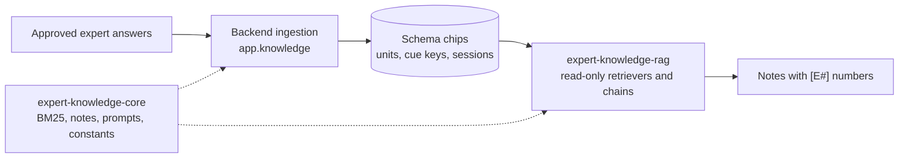

# About retrieval and indexing

Language: **English** · [Polski](../../pl/explanation/retrieval-and-indexing.md)

The system keeps one searchable store of expert knowledge in Postgres, the schema `chips`, and it combines a dense bge-m3 embedding with a BM25 sparse vector. The web backend writes approved expert findings to `chips`. The BM25 code, the note packing and the retrieval constants live in the framework-free package `expert-knowledge-core`, so ingestion and retrieval use one copy; the package `expert-knowledge-rag` reads `chips` through a read-only connection. This page explains why the parts are shaped this way. The lists of names, signatures and defaults are in [Packages](../reference/packages.md).

## How it fits together

The backend stores units, cue keys and sessions and fits BM25 over them. Dotted lines show code reuse of the core package; `expert-knowledge-rag` queries `chips` and returns notes that its chains hand to a chat model. The evaluation scripts in `scripts/rag/` reach the same query embedder and BM25 settings through `rag_common.py`, which reads `config/indexing.yaml`.

### Indexing: dense and sparse in one row

The dense vector is the bge-m3 embedding of the unit text (`vector(1024)` columns in `chips`). The sparse vector holds BM25 weights, so that a plain inner product between a stored vector and a query vector equals the BM25 score. This lets one pgvector column and one operator (`<#>`, negative inner product) express BM25 inside Postgres. Terms are hashed into 2^20 dimensions, so no vocabulary table exists; a hash collision only merges two terms (docstring of `bm25.py`). Migration 0003 creates the `sparsevec(1048576)` columns without a vector index, so a search is an exact scan.

BM25 needs corpus-wide statistics (`idf` and the average document length). The backend therefore refits the sparse vectors over everything in `chips` after an ingestion (`refresh_sparse` in `ingest.py`). A change of BM25 settings needs a refit but no new embedding, because the dense vector does not depend on the sparse settings.

### Retrieval: ranking, fusion and notes

A search ranks candidates twice, once by dense cosine distance and once by BM25, and fuses the two rankings with reciprocal rank fusion: the score of an item is the sum of `1 / (RRF_K + rank)` over the rankings. Fusion works on ranks, so it needs no common scale for cosine and BM25 values. A row that shares no term with the query has a BM25 score of 0 and is not a match in the sparse ranking. A query that consists only of stopwords has no sparse vector, so a hybrid search falls back to the dense ranking alone.

The expert store holds findings units: one per targeted highlight, plus one for the sentences about the case as a whole. Each unit has one embedded text, `i1` (the reviewed text), with a dense and a sparse vector; the patient's words are embedded separately as cue keys. Questions search `i1`. Two retrievers enter this store:

- `ExpertQuestionRetriever` searches the units with a clinician's question.
- `PatientTextRetriever` splits a patient's text into sentences, ranks the cue keys (the patient's words that experts highlighted) per sentence, fuses the sentence rankings, and ranks units by their own cue's score plus a bonus for the other cues cited together with it. A combination of patient words therefore outranks a single one.

Generic answers about the case as a whole repeat across sessions and would fill a general question's result. The question retriever pushes a case unit that is a near-duplicate (cosine at least `NEAR_DUPLICATE`) of a better-ranked case unit to the end.

A hit is not returned as a raw row. The retrievers load the session's findings record and pack the units into a note: the case line, the patient's words with the expert's direction marks, and the expert's own sentences, each once, with citation chips rendered as short quotes. Units of one session that share a sentence are merged into one note, so a sentence is not repeated. The chains number the notes `[E1]`, `[E2]` and so on, and the evaluated system prompts ask the model to cite them. When no note is found, the chains answer `NOT_IN_SOURCES` and do not call the model: without notes a model answers from general knowledge, which the chains are meant to prevent (docstring of `chains.py`).

## Why `expert-knowledge-core` is framework-free

The core package holds what the web backend's ingestion and the retrieval package must agree on: the BM25 sparse vectors, the notes, the findings record, the prompts and the retrieval constants. It has no LangChain, web framework or database driver (docstring of `__init__.py`; dependencies in `pyproject.toml` are pydantic, pgvector and snowballstemmer).

Each of these items must be identical on both sides. A query has to be tokenised exactly as the stored vectors were, or BM25 weights and query terms do not meet. The text that was embedded and the text that is packed into a note must stay in step (docstring of `notes.py`). The record that ingestion writes must be the record that retrieval reads, which `FINDINGS_VERSION` guards: a record with another version is not read. The package docstring names its purpose as what the web application's ingestion and the retrieval package must agree on: one copy of these items, with no LangChain, no web framework and no database driver (`__init__.py:1-7`). The backend's indexing config reuses `Bm25Config` from the core package, so the indexing YAML and the retrievers validate the same settings.

## Why `expert-knowledge-rag` is read-only

`ExpertKnowledgeStore` runs every call in a transaction that begins with `SET TRANSACTION READ ONLY`. The docstring gives the reason: a bug or a hostile query string cannot change the knowledge base. Writing is the job of the backend's ingestion, which stores the units, computes their embeddings and refits BM25.

Other choices in the package support use from different hosts. When the store opens its own connection from a DSN, it passes `prepare_threshold=None` (`store.py:64`, `:91`), so no prepared statements are used; the class docstring gives the reason: this keeps it working behind a connection pooler (`store.py:19-22`). With `pool=` or `async_pool=` the store uses the connection that the caller's pool hands out, unchanged (`store.py:59-61`, `:86-88`). The store accepts a DSN, a sync pool or an async pool. Vectors travel as text and are cast in SQL (`CAST(CAST(x AS text) AS vector)`), so no codec has to be registered on the connection. The schema name is quoted as an identifier, and filters become parameterised conditions. The backend's admin search uses these retrievers directly, so a hit in that tool is a hit an answering application would get (docstring of `search.py`).

## Constraints and trade-offs

Several values are the same number in different places and must stay equal:

- The embedding model and width: `EMBEDDING_MODEL` and `EMBEDDING_DIMENSIONS` in the core package, `embeddings.model` and `dimensions` in `config/indexing.yaml`, and the `vector(1024)` columns in the database. `ExpertKnowledgeStore.vector_text` rejects a query vector of the wrong width, and `config/indexing.yaml` states that `dimensions` is checked against the model output and the table column.
- The sparse width: `DIMENSIONS` (`1 << 20`) and the `sparsevec(1048576)` columns.
- The BM25 settings: the retrievers' `bm25` field must equal the `sparse` block of `config/indexing.yaml` that the stored vectors were fitted with.

The design gives up some things for simplicity. BM25 is refitted for the whole corpus on every ingestion; the backend comment marks this as a shortcut that suits hundreds of units. The searches on `chips` are exact scans without a vector index. The prompts and constants are the ones that were evaluated, and the prompt module states that changing a word changes what was measured.

## Related pages

- [Packages](../reference/packages.md) - API, constants and defaults of both packages
- [Backend: indexing and proofreading](../reference/backend-indexing-proofread.md) - the backend modules that use the core package
- [Backend core API](../reference/backend-core-api.md) - embedder and settings in the backend
- [Architecture](architecture.md) - containers of the whole system
- [Documentation index](../index.md)

## Sources in code

- `packages/expert-knowledge-core/src/expert_knowledge_core/__init__.py` - purpose of the core package
- `packages/expert-knowledge-core/src/expert_knowledge_core/bm25.py` - sparse BM25 design, hashing, tokenising
- `packages/expert-knowledge-core/src/expert_knowledge_core/notes.py` - note packing and why one copy exists
- `packages/expert-knowledge-core/src/expert_knowledge_core/records.py` - findings record and version guard
- `packages/expert-knowledge-core/src/expert_knowledge_core/prompts.py` - evaluated prompts and abstention reply
- `packages/expert-knowledge-core/src/expert_knowledge_core/retrieval.py` - retrieval constants
- `packages/expert-knowledge-core/pyproject.toml` - core dependencies
- `packages/expert-knowledge-rag/src/expert_knowledge_rag/store.py` - read-only transactions, pools, prepared statements
- `packages/expert-knowledge-rag/src/expert_knowledge_rag/retrievers.py` - the two retrievers and their steps
- `packages/expert-knowledge-rag/src/expert_knowledge_rag/sql.py` - hybrid SQL, RRF, index i1, text-cast vectors
- `packages/expert-knowledge-rag/src/expert_knowledge_rag/ranking.py` - near-duplicate rule and cue scoring
- `packages/expert-knowledge-rag/src/expert_knowledge_rag/documents.py` - packing hits into notes
- `packages/expert-knowledge-rag/src/expert_knowledge_rag/chains.py` - abstention and [E#] numbering
- `scripts/rag/rag_common.py:1-35` - query embedder and BM25 settings of the scripts
- `config/indexing.yaml` - embedding and sparse settings
- `backend/migrations/versions/0003_pipeline.py:55,94` - vector and sparsevec columns of chips
- `backend/app/indexing/config.py` - IndexingConfig reuses Bm25Config
- `backend/app/indexing/__init__.py` - indexing package imports the core bm25 module
- `backend/app/knowledge/ingest.py:285-377` - units, cue keys and the BM25 refit over chips
- `backend/app/knowledge/search.py:1-94` - admin search uses the rag retrievers
