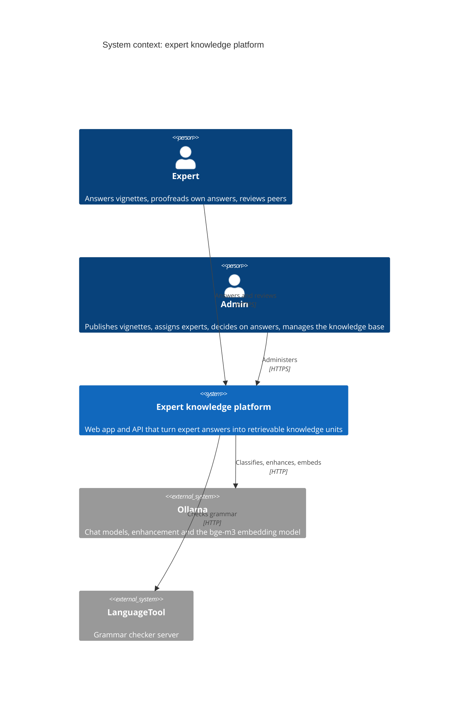
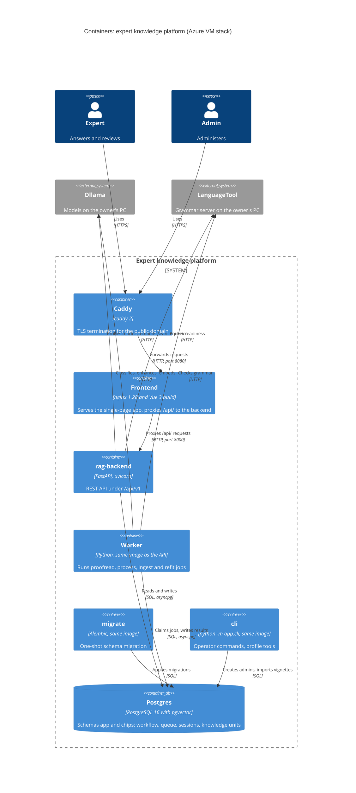
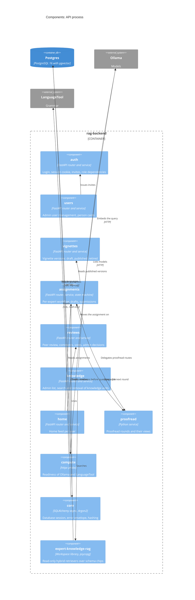
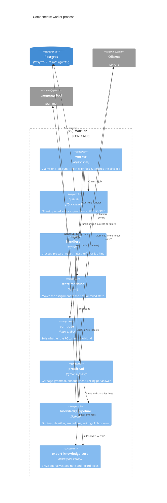
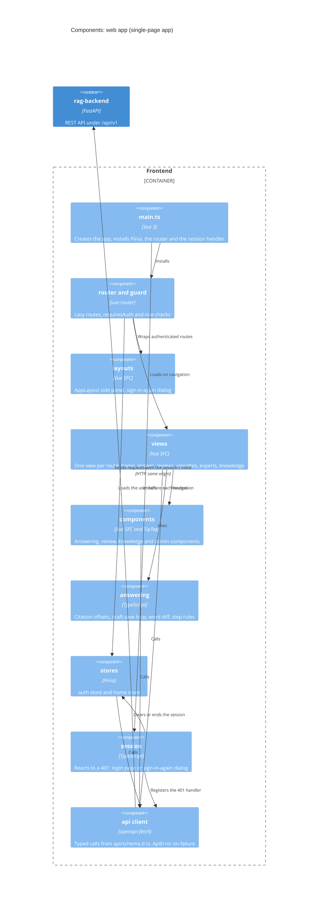

# About the architecture

The system is a web platform that collects written answers from experts to case vignettes,
has the answers proofread and peer-reviewed, and turns the approved ones into searchable
knowledge units. It has a Vue single-page app, a FastAPI backend, a background worker that
runs the slow steps, one PostgreSQL database, and two services that run language models and
grammar checks (Ollama and LanguageTool). This page shows the system at three levels (context,
containers, components) and lists the values that must agree between the parts.

The diagrams use the C4 model in Mermaid. The container diagram follows the stack in
`infra/azure/docker-compose.yml`; the local development stack in `docker-compose.yml` differs
in a few places that are listed after it.

## System context

Two kinds of people use the platform: the `expert` and the `admin` role (`Role` enum). Experts
answer assigned vignettes, check the proofread version of their own answers and review the
answers of others. Admins publish vignettes, assign experts, decide on reviewed answers, retry
failed jobs and search or prune the knowledge base. The platform calls two external HTTP
services: Ollama for the classifier, the enhancement model and the `bge-m3` embeddings, and
LanguageTool for grammar. On the Azure VM both run on the owner's PC and are reached at
`PC_HOST`; in the local compose stack they are compose services.

## Containers

A visitor reaches Caddy over HTTPS. Caddy forwards everything to the nginx container, which
serves the built single-page app and proxies paths under `/api/` to the backend, so the page and
the API share one origin and the session cookie needs no CORS. The backend answers requests and
writes the state of each assignment to Postgres. Steps that take long (proofreading, cutting
answers into units, embedding, refitting the BM25 index) are not run in the request: the
state machine inserts a row in the `jobs` table and the worker, a second process from the same
image, claims it, calls Ollama and LanguageTool and writes the result back to the same database.
The queue, the sessions and the audit trail are tables in Postgres; no broker or cache container
exists. `migrate` runs `alembic upgrade head` before the API and the worker start, and `cli`
runs `create-admin`, `import-vignettes` and `export-openapi` on demand.

The local stack in `docker-compose.yml` differs from the diagram in these places:

- No Caddy. The `frontend` service is the Vite dev server on port 5173, which proxies `/api` to
  `rag-backend:8000`; the `frontend-preview` service (profile `preview`) runs the production
  nginx image on port 8080.
- `ollama` and `languagetool` are compose services, not an external machine.
- The compose file also starts MinIO (bucket and app user created by `minio-init`), pgAdmin
  (profile `tools`), a Playwright MCP browser (profile `browser`) and a `dev` workspace. The
  backend code under `backend/app` has no S3 client; the S3 client is in
  `scripts/corpus/storage.py`, so MinIO belongs to the corpus scripts and not to the web
  platform diagram.
- Postgres runs `backend/db/init.sql` at first start, which creates the `public.documents` and
  `public.chunks` tables for the literature corpus. The VM stack does not mount that file.

## Components: backend

The API and the worker are one Python package, `backend/app`, started with two commands
(`uvicorn app.main:app` and `python -m app.jobs.worker`). The next two diagrams split it by
process.

`app/main.py` mounts seven routers under `/api/v1`: auth, users, vignettes, assignments,
reviews, knowledge and home, plus a `/health` route. Every router imports the role dependencies
of `auth` (`CurrentUser`, `AdminUser`), which is why the diagram draws no arrow for them. The
`assignments` component holds the state machine; its `transition()` function is the only writer of
`Assignment.state`, records an audit event and inserts the `Job` row for a state that is run by
the worker. `reviews` and `home` read and drive the same assignment rows, and the proofread
screens of an assignment are served by `proofread` through the assignments router. When
`REQUIRE_COMPUTE` is on, the application's lifespan starts `compute.watch()`, which probes Ollama
and LanguageTool every ten seconds, and a request that would queue a job gets a 503 when the
last probe lacks a required model or LanguageTool. The knowledge search is the only API path
that uses the `expert-knowledge-rag` retrievers: they embed the query through Ollama and read
the `chips` schema through a read-only psycopg connection.

The worker imports `app.models` so that it knows every table without starting the API. `run_once()`
claims one job, runs the slow preparation (`PREPARE`: proofread or embedding) without a lock, and
then runs the handler and the state transition in one commit under a row lock on the assignment.
A job that fails permanently, or on its last attempt, moves the assignment to a `*_failed` state;
an admin retry re-queues it. The `proofread` pipeline chains garbage removal, LanguageTool,
the enhancement model, LanguageTool again and layout. The `knowledge pipeline` cuts approved answers into
fragment and case units, files uncited sentences with the classifier model, embeds the unit
texts with `bge-m3`, writes the `chips` rows in one transaction under an advisory lock and refits
BM25 over the whole corpus. See [Assignment lifecycle](assignment-lifecycle.md) for the states
and [Retrieval and indexing](retrieval-and-indexing.md) for the units and the index.

## Components: web app

`frontend/src/main.ts` mounts the app with Pinia, the router and the session handler. The router
(`frontend/src/router/index.ts`) lazy-loads every view except the login-protected shell
`AppLayout` and `HomeView`; before each navigation it asks the `auth` store for the current user
(`GET /api/v1/me`) and `guardRoute` applies the `requiresAuth`, `guestOnly` and `roles` route
metadata. Views render components and call the API client directly or through the `auth` and
`home` stores; the `answering` helpers hold the pure logic for citations and drafts. The client
(`frontend/src/api/client.ts`) is built from the types in `src/api/schema.d.ts`, which
`npm run gen:api` generates from `frontend/openapi.json`; `python -m app.cli export-openapi`
writes that OpenAPI document. The client uses `window.location.origin` as its base URL and
turns every non-2xx answer into an `ApiError`; a 401 calls the handler installed by `session.ts`,
which sends the user to the login page, or, on a route marked `keepOnExpiry` (the answering
and review pages), asks for the password over the page. The component catalogue is in
[Frontend components](../reference/frontend-components.md).

## Constraints and trade-offs

- **One database holds all state.** Assignments, the job queue, sessions, audit events, vignettes
  and the ingested knowledge units are tables of one Postgres instance in two schemas, `app`
  (SQLAlchemy models, Alembic autogenerate) and `chips` (created by migration 0003 with plain SQL,
  written by raw SQL in `knowledge/ingest.py` and read by `expert-knowledge-rag`). The only
  volume that carries application data on the VM is `postgres-data`; `infra/azure/backup.sh`
  writes a daily `pg_dump` of it and keeps seven days.
- **The API and the worker must run the same code and settings.** Both start from one image
  (`infra/backend.Dockerfile`) with the same environment block, and both read `prompts/` and
  `config/` relative to `settings.project_root`. The worker needs `prompts/` and `config/` next
  to `backend/`, which the Dockerfile copies and the local compose file mounts.
- **The embedding model and sizes must match everywhere.** `bge-m3` with 1024 dimensions is set in
  `config/indexing.yaml` and in `expert_knowledge_core/retrieval.py`; the embedder checks the
  model output against `embeddings.dimensions`, and `ExpertKnowledgeStore` checks the query width.
  The BM25 hash space `1 << 20` equals the `sparsevec(1048576)` columns, and the `sparse` block in
  `config/indexing.yaml` equals the `Bm25Config` defaults.
- **The models must exist on the Ollama machine.** With `REQUIRE_COMPUTE`, a job kind is ready only
  when Ollama lists the models it needs (`CLASSIFIER_MODEL`, a non-empty `ENHANCE_MODEL`, or the
  embedding model from `config/indexing.yaml`) and, for proofreading, LanguageTool answers.
  Otherwise the API refuses the request with 503 `compute_unavailable` and the worker leaves the
  job queued. The VM stack sets `REQUIRE_COMPUTE` to `"true"`.
- **The paths and ports of the web tier agree.** The API prefix is `/api/v1`
  (`backend/app/main.py`); nginx and the Vite dev server both forward `/api`; Caddy forwards to
  `frontend:8080`, which is the nginx `PORT`; `API_UPSTREAM_URL` is `http://rag-backend:8000`
  and `API_HOST` is its host name. A mismatch in any of them breaks the same-origin cookie setup.
- **The session cookie depends on the environment.** The cookie is named `session`, and
  `ENVIRONMENT=production` (the VM default) forces the secure attribute.
- **The worker reports health through a file.** It touches `/tmp/worker-alive` every ten seconds
  and the VM healthcheck fails when the file is older than sixty seconds; `deploy.sh` waits for
  the `rag-backend`, `worker` and `frontend` containers to be healthy.
- **The VM is sized by limits.** `infra/azure/docker-compose.yml` sets memory limits that add up
  to about 2 GB and a Postgres with `max_connections=30`.

## Related pages

- [Documentation index](../index.md)
- [Assignment lifecycle](assignment-lifecycle.md)
- [Retrieval and indexing](retrieval-and-indexing.md)
- [Backend core API](../reference/backend-core-api.md)
- [Backend assignments and jobs](../reference/backend-assignments-jobs.md)
- [Backend reviews](../reference/backend-reviews.md)
- [Backend vignettes and knowledge](../reference/backend-vignettes-knowledge.md)
- [Backend indexing and proofread](../reference/backend-indexing-proofread.md)
- [Packages](../reference/packages.md)
- [Chunking](../reference/chunking.md)
- [Frontend app](../reference/frontend-app.md)
- [Frontend components](../reference/frontend-components.md)
- [Runtime and deploy](../reference/runtime-and-deploy.md)

## Sources in code

- `docker-compose.yml` - local services, profiles, ports, environment, dependencies between services
- `infra/azure/docker-compose.yml` - VM containers, shared backend environment, healthchecks, limits, tools profile
- `infra/azure/Caddyfile` - Caddy reverse proxy to the frontend container
- `infra/azure/env.example` - VM variables such as the PC host and environment
- `infra/azure/backup.sh` - daily pg_dump of the database
- `infra/azure/deploy.sh` - waits for the healthy containers
- `.github/workflows/deploy.yml` - images built from the two infra Dockerfiles
- `backend/Dockerfile` - local backend image, copies of prompts and config
- `infra/backend.Dockerfile` - production backend image and uvicorn command
- `infra/frontend.Dockerfile` - production frontend image with nginx
- `frontend/nginx/default.conf.template` - /api/ proxy, health route, single-page fallback
- `frontend/vite.config.ts` - /api proxy of the dev server
- `frontend/package.json` - gen:api script and frontend dependencies
- `frontend/openapi.json` - OpenAPI document that the types are generated from
- `backend/app/main.py` - mounted routers, API prefix, lifespan with compute watcher
- `backend/app/cli.py` - create-admin, export-openapi and import-vignettes commands
- `backend/app/settings.py` - settings, project root, environment and cookie fields
- `backend/app/compute.py` - probes of Ollama and LanguageTool, readiness per job kind
- `backend/app/core/db.py` - async engine, schema app, database URL
- `backend/app/auth/router.py` - role dependencies and session cookie routes
- `backend/app/auth/service.py` - session cookie name and secure flag
- `backend/app/auth/dependencies.py` - CurrentUser and AdminUser
- `backend/app/users/router.py:6,40,61` - the users router imports and calls issue_invite from the auth service
- `backend/app/users/service.py:11` - user create, update and person cards; imports end_all_sessions from the auth service
- `backend/app/assignments/router.py` - routes delegating to proofread
- `backend/app/assignments/service.py` - use of vignettes
- `backend/app/assignments/state_machine.py` - only writer of the state, job queueing, compute gate
- `backend/app/reviews/service.py` - use of assignments, proofread and knowledge
- `backend/app/home/service.py` - reads of assignments, reviews and jobs
- `backend/app/knowledge/router.py` - admin knowledge routes
- `backend/app/knowledge/search.py` - use of the retrievers and the read-only connection
- `backend/app/knowledge/embedding.py` - embedder from config, dimension check
- `backend/app/knowledge/ingest.py` - raw SQL into schema chips, advisory lock, BM25 refit
- `backend/app/jobs/worker.py` - worker loop, alive file, transitions, compute check
- `backend/app/jobs/handlers.py` - handlers and prepare steps per job kind
- `backend/app/jobs/queue.py` - job claim query
- `backend/app/proofread/pipeline.py` - proofread chain
- `backend/app/proofread/grammar.py` - LanguageTool client
- `backend/app/proofread/enhance.py` - enhancement call to Ollama
- `backend/app/proofread/links.py` - linking and classifier use
- `backend/app/ollama.py` - Ollama chat client
- `backend/app/embeddings.py` - Ollama embedding client
- `backend/migrations/env.py` - Alembic manages only schema app
- `backend/db/init.sql` - public tables created by the local Postgres container
- `config/indexing.yaml` - embedding model, dimensions, BM25 parameters
- `packages/expert-knowledge-core/src/expert_knowledge_core/retrieval.py` - embedding model and dimensions constants
- `packages/expert-knowledge-core/src/expert_knowledge_core/bm25.py` - hash space size
- `packages/expert-knowledge-rag/src/expert_knowledge_rag/store.py` - read-only store, schema chips, width check
- `scripts/corpus/storage.py` - S3 client used by the corpus scripts
- `frontend/src/main.ts` - app bootstrap
- `frontend/src/router/index.ts` - routes, lazy loading, guard call
- `frontend/src/router/guard.ts` - route metadata checks
- `frontend/src/api/client.ts` - typed client, ApiError, 401 handler
- `frontend/src/session.ts` - 401 handling
- `frontend/src/stores/auth.ts` - auth store calls
- `frontend/src/stores/home.ts` - home store calls
- `frontend/src/layouts/AppLayout.vue` - layout, stores and sign-in dialog
- `frontend/src/views/AnswerView.vue` - views importing components, answering helpers and the store
