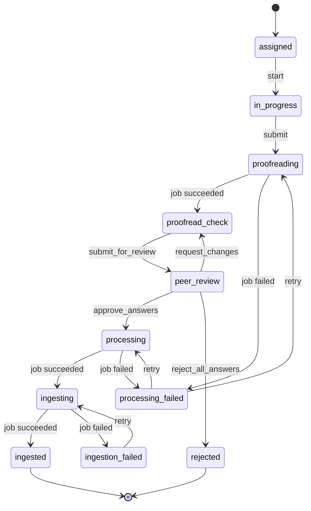

# About the assignment lifecycle

Language: **English** · [Polski](../pl/explanation/assignment-lifecycle.md)

An assignment is one expert answering one published vignette version. Its life runs from the admin's assignment, through answering, proofreading, peer review and processing, to ingestion of the approved answers as knowledge units, or to a rejection or cancellation. This page explains how the pieces that carry an assignment along fit together and why they are shaped as they are: a single state machine, a Postgres-backed job queue that does the slow work, and a review that only the admin closes. The tables of states, routes and constants are in [backend-assignments-jobs.md](../reference/backend-assignments-jobs.md) and [backend-reviews.md](../reference/backend-reviews.md); they are not repeated here.

## How it fits together

### One writer of the state

`Assignment.state` has one writer, `transition()` in `state_machine.py`. A transition table maps a (state, action) pair to a target state and the actors allowed to take it, so an illegal move and a move by the wrong actor are rejected in one place (409 `illegal_transition`, 403 `forbidden`). The same call records the audit event and, when the target state has a job, adds the `Job` row. The caller holds the assignment's row lock and commits, so the state change, its audit event and its queued job reach the database together or not at all.

The audit events are the assignment's timeline. They are shown through two views: the admin sees the actor and metadata of each event, while the author sees a role (`you`, `admin`, `reviewer`, `system`) and does not see the discussion events (`review_opened`, `comment_added`, `vote_cast`), because the author's timeline is for the workflow.

The diagram shows the transitions of `TRANSITIONS`, with `cancel` omitted: the admin can cancel from `assigned`, `in_progress`, `proofread_check` and `peer_review`, and `cancelled` is the third terminal state next to `ingested` and `rejected`. A cancelled assignment is left out of the unique index on (version, expert), so the expert can be assigned the same version again.

### People move some states, workers move others

The states fall into two groups. In `assigned`, `in_progress`, `proofread_check` and `peer_review` the assignment waits for a person: the author, a reviewer or the admin. In `proofreading`, `processing` and `ingesting` (`JOB_STATES`) a background job is working, and the assignment waits for the worker; the comment in `states.py` notes that the frontend polls while it sees one of these states, and `AssignmentSummary.job_running` exposes the same fact. The failed states, `processing_failed` and `ingestion_failed`, wait for the admin.

Entering a job state queues the job of that state (`JOB_ON_ENTRY`). When the worker finishes, it calls `transition` as the `system` actor with the matching success action, or with the failure action. The success and failure actions are not among the names a user can see in `allowed_actions`, so a state is moved either by a person through a route or by the worker.

### The queue and the worker

The queue is the `jobs` table. A worker process (`python -m app.jobs.worker`) claims the oldest `queued` job, or a `running` job whose lease has expired, with `FOR UPDATE SKIP LOCKED`, so several workers run side by side without taking the same job. A partial unique index allows at most one live job per assignment and kind. A worker holds a job through a lease, not a connection: a heartbeat renews the lease while the job runs, so a long job is not taken over, and a crashed worker's job is taken over one lease later. A job whose worker died with all attempts used fails with `LeaseExpired`.

Slow work is separated from recording the result. Each job kind has an optional `PREPARE` step (proofreading and embedding use models and the network) that runs with no transaction and no row lock open, and a `HANDLER` that records the result under the assignment lock in the same transaction as the success transition. The handler runs only if the job is still the current attempt (`_current`), so a worker whose lease was taken over cannot record a stale result. Cutting answers into units has no prepare step: it calls no model.

A failing job is retried up to `MAX_ATTEMPTS`. A `PermanentJobError` (nothing to build from, no units, units without embeddable text) fails at once. When the exception was raised because the machine that hosts the models is down, the job returns to the queue without using an attempt. The job keeps only the exception class as `last_error`, because messages could quote an expert's text. After the final failure the assignment moves to the failure state of its job.

`proofread` and `process` failures both lead to `processing_failed`, so that state is shared by two jobs. The admin's `retry` therefore looks at the most recent failed job of the assignment and takes the retry action of its kind. The worker does not retry on its own beyond `MAX_ATTEMPTS`; the admin does.

A third kind of job, `refit`, has no assignment. It refits the sparse index after knowledge units are removed, takes an advisory lock, and moves no workflow, which is why `assignment_id` is nullable.

### The compute gate

The models for proofreading and embedding can run on another machine than the API (`app/compute.py`). With `REQUIRE_COMPUTE` on, two places check it. The API checks before a user action enters a job state and answers 503 `compute_unavailable` instead of queueing a job that cannot run; approving answers also checks the embedding model, because ingestion follows processing without a person in between (`FOLLOWED_BY`). The worker checks before it claims a job, so a job whose machine is down stays queued while the others run. The API reads the last probe that a background task renews, so no request waits on the network while it holds the row lock. The worker's own moves are not checked in `transition`.

### Answering and submitting

The expert's draft lives in `answer_drafts`, apart from the assignment row, because autosave overwrites it. Each save carries the version it is based on; a stale version gives 409 `draft_conflict`, which protects against a second browser tab. Saving a draft is lenient about completeness so that questions can be answered in any order; submitting checks everything. The submission is a separate `submissions` row, frozen (the model docstring says a database trigger rejects updates), and it stores the hash of the vignette version the answers refer to.

### Proofreading and the author's check

Submitting queues the `proofread` job. Its preparation proofreads every written answer and links each filed sentence to the citations the author made; its handler stores the result as a proofread round for the assignment's current `review_round`. The grammar checker and the model are optional in the pipeline: an unreachable one skips its pass and records that, unless `REQUIRE_COMPUTE` is on, when the job fails and waits for the machine instead of handing the author an unchecked answer.

In `proofread_check` the author edits the proofread text and the links. Submitting for review requires every answer to be non-empty and every line of a filed answer to be linked to a quote or the case. Setting `submitted_at` on the round is what the review code uses to know that a round was submitted.

### Peer review

Reading a colleague's answers colours one's own, and the code treats that as the central constraint of the review. Every active expert may read a submission under review, except its author and anyone who still has to answer the vignette (on any version). The rule is checked on each request instead of being fixed at submission, so an expert who joins later sees the review as well. Reading is explicit: a reviewer opens the review before any text is sent, and the `review_participants` row this creates excludes them from being assigned that vignette later (`reviewer_contaminated`). A `GET` therefore never causes the exclusion by itself.

Reviewers and others discuss and vote, but the decision is the admin's. Votes are advisory and can be changed until the review closes. A vote carries the round the reviewer looked at, and a vote for an answer that has since been edited is refused (`stale_round`) instead of landing on text nobody read. Comments are never edited, because decisions rest on what was said. Only reviewers take a stance on a comment, since the author taking a side on their own work would be a vote for it.

The admin decides each answer exactly once. An approval is recorded with a hash of the reviewed text and links, so it applies to exactly that text. A single `request_changes` sends every answer back: `review_round` increases, the assignment returns to `proofread_check`, and the new round copies the previous round's text, links and flags with the admin's comments as feedback. Comments and votes of the next review belong to the new round. Without change requests, the approved answers go to `processing`; if no approved answer is one that is cut into units, the submission is `rejected`. Only open questions other than Q4 are cut into units; Q4's explanation and the rating are not.

### Processing and ingestion

The `process` job builds a findings record from the submission and the approved answers' final lines, writes the knowledge units with status `approved`, and the transition moves the assignment to `ingesting`. Nobody reads the units before ingestion, according to the handler's docstring. The `ingest` job embeds the units in its preparation, then writes them into the retrieval tables and sets their status to `ingested`, and the assignment reaches the terminal state `ingested`. The admin can inspect how the approved answers were filed through the findings view, which the author never sees.

## Constraints and trade-offs

- State, audit event and job are written in one transaction under the row lock. The price is that every route that changes an assignment locks its row first, and the worker takes the same lock, in the same order, on both its success and failure paths.
- Slow work happens outside any lock. The price is that the result may belong to a job that lost its lease, which `_current` checks, and that a `PREPARE` step may run again after a retry; proofreading replaces the round it recorded earlier.
- The `processing_failed` state is shared by two job kinds. The price is that its meaning is read from the jobs table.
- Review access is evaluated on every request and reading is recorded explicitly. The price is an extra `review/open` step for reviewers, and that an expert who opened a review of a vignette cannot be assigned that vignette.
- Approval is tied to a content hash and a vote to a round. The price is that an edit after a change request restarts discussion and voting in the new round.
- The number of reviewers per assignment is not limited in the reviewed modules.

## Related pages

- [Assignments and jobs reference](../reference/backend-assignments-jobs.md)
- [Reviews reference](../reference/backend-reviews.md)
- [Indexing and proofread reference](../reference/backend-indexing-proofread.md)
- [Vignettes and knowledge reference](../reference/backend-vignettes-knowledge.md)
- [Core API reference](../reference/backend-core-api.md)
- [Architecture](architecture.md)
- [Documentation index](../index.md)

## Sources in code

- `backend/app/assignments/state_machine.py` - transition table, single writer, job queuing, compute check
- `backend/app/assignments/states.py` - states, job states, terminal states and the polling comment
- `backend/app/assignments/service.py` - assigning, contamination check, drafts, submit, retry, timeline views
- `backend/app/assignments/models.py` - draft and submission tables, partial unique index on active assignments
- `backend/app/assignments/answers.py` - lenient draft checks and strict submission checks
- `backend/app/jobs/queue.py` - claim query, lease and attempts
- `backend/app/jobs/worker.py` - prepare/handler split, heartbeat, retry and failure paths
- `backend/app/jobs/handlers.py` - process, ingest and refit handlers, PREPARE and HANDLERS tables
- `backend/app/jobs/models.py` - job table, unique index of live jobs, last_error rationale
- `backend/app/jobs/errors.py` - permanent errors
- `backend/app/reviews/service.py` - opening, comments, votes, decisions and rounds
- `backend/app/reviews/access.py` - who may read a review and why
- `backend/app/reviews/models.py` - participants, comments, votes, decisions and their rationale
- `backend/app/proofread/service.py` - proofread job, check by the author, submit for review, next round
- `backend/app/proofread/pipeline.py:1-30` - optional passes and the REQUIRE_COMPUTE exception
- `backend/app/compute.py` - probe and its use by the API and the worker
- `backend/app/knowledge/findings.py:76-79` - which answers are cut into units
