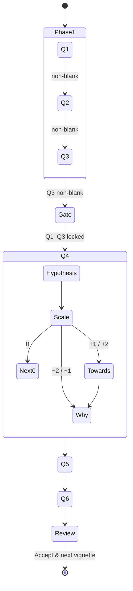

# Vignettes in the frontend

How the web elicitation platform should show a vignette and collect a clinician's answers. It
covers structure and behaviour, not a framework. The API and the workflow around it are in
[backend-workflow.md](backend-workflow.md). The API's types are generated into
`frontend/src/api/schema.d.ts`, so field names are not repeated here where they can be looked up.

## 1. What the frontend gets

`GET /api/v1/assignments/{id}` returns everything the answering screen needs:

| Field | What | Notes |
|---|---|---|
| `vignette` | `code`, `version`, `text`, `framing`, `word_count`, `content_hash` | Never the hidden `design` block: it holds the planted cues and is what the answers are scored against. A/B variant information isn't sent either. |
| `vignette.questions[]` | `id`, `kind`, `text`, `min_words` | Only the questions the expert may see now, in order, with the text as shown (Q4's what-if is filled in). `kind` is `open`, `shift` (Q4) or `rating_1_5` (Q6). `min_words` is the minimum of different words, for a counter. |
| `vignette.questions[].wording` | The wording of the Q4 step | Use these strings rather than rewording them, so all answers are given to the same item. |
| `draft` | `version`, `payload` | The saved answers and citations. |
| `locked_highlights` | How many citations were made before the lock-in | The first this many can't change. |
| `allowed_actions` | e.g. `save_draft`, `pass_gate`, `submit` | Show only these actions; the server owns the workflow rules. |

Every vignette asks Q1–Q6, so every vignette has a what-if.

## 2. Screen layout

An expert first sees a list of their vignettes (`/assignments`), and opens one (`/assignments/:id`).

```
┌───────────────────────────────────────────────────────────────────────┐
│ Vignettes / V001  Personal journal   Q1 Q2 Q3 🔒 Q4 Q5 Q6 Review  Saved│
├───────────────────────────────────┬───────────────────────────────────┤
│ vignette text, always in view     │ Q2 Which of those fragments…      │
│                                   │ ┌───────────────────────────────┐ │
├───────────────────────────────────┤ │ [2] could just as easily…     │ │
│ Citations                         │ └───────────────────────────────┘ │
│ [1] "numbers on…"  Away from… Cite│ 12 of 10 different words          │
│ [2] "I haven't…"   Direction… Cite│                                   │
│                                   │ Back                Next question │
└───────────────────────────────────┴───────────────────────────────────┘
```

- **The vignette text and the citations stay on screen for every question.** On a narrow screen the
  columns stack.
- **Selecting text with the mouse adds a citation** to the table when the button is released. The
  selection grows to whole words and loses spaces at its edges. Selecting the same passage again
  points at the existing row. On a touch screen or with the keyboard, a "Cite selection" button
  confirms the selection instead.
- **Nothing is highlighted in the text, except while a citation is hovered or focused:** a row of the
  table, or a chip in an answer. Passages may overlap, because only one is lit at a time.
- **Each citation has a number and a colour** (8 colours, repeating). The colour follows the number,
  and the number is always shown, so colour is never the only cue.
- **Each citation needs a direction:** `toward`, `away`, `neutral` or `unclear`.
- **Answers are free text with chips.** Cite in the table inserts a chip at the cursor. A chip is one
  unit: backspace removes all of it. Removing a citation takes its chips out of the answers, and moves
  the later citations and their chips up one number, so the numbers are always 1..n.
- **Soft checks never block.** A citation not cited in any answer is noted on its row and in the
  lock-in and submit dialogs. A Q1 answer over about 60 words with no chips asks which fragments it is
  about. Having no citations at all is a warning at the lock-in: some texts have nothing to cite.
- One question at a time. A long single page makes it too easy to read ahead, and Q4–Q6 must not be
  seen early (see §3).

## 3. The question flow per vignette



### Phase 1: Q1–Q3, the gate

- Q1, Q2 and Q3 are open questions. **Each needs an answer with at least `min_words` different words**
  before Next moves on. Chips aren't words. The check is here because these answers can't be corrected
  once the gate is passed. **Every citation also needs a direction** before the lock-in.
- **Q4–Q6 are not rendered, and not even sent to the client, until all three are answered.** The
  answers to Q1–Q3 are the expert's reading of the text before they see the what-if or the rating.
- **Passing the gate locks Q1–Q3 and the citations made so far.** Q3's button is "Lock in results",
  which asks for confirmation, saves the draft and calls `POST /assignments/{id}/pass-gate`. That
  records `gate_passed_at` and `locked_highlights`, and returns Q4–Q6. From then on the server refuses
  changes to Q1–Q3 and to those citations, including their directions (`gate_locked`). Back still shows
  the answers, read-only, with a note "locked: you have seen the questions after this one".
- **New citations can still be added after the lock-in,** and changed or removed until submitting.
  `locked_highlights` is frozen with the submission, so analysis can tell the citations made before the
  what-if was seen from those made after it.
- If a vignette asks only some of Q1–Q3, the gate is the ones it asks.

### Phase 2: Q4, Q5, Q6

**Q4: the what-if (a short Script Concordance item).** Its heading is the rendered question, with
the what-if emphasised:

> Given your hypothesis about this person so far: how would it change if **the writer had an exam
> earlier that day**?

The step has four parts, in this order:

1. **Your working hypothesis, in one sentence (required).** A one-line text field. A classic SCT
   item states the hypothesis; here the expert formed their own in Q1–Q3, and this line names it, so
   a shift has something to point at.
2. **The scale (required).** A slider with 5 stops, headed **"With this, my hypothesis…"**:

   | value | label (`SHIFT_LABELS`) |
   |---|---|
   | −2 | is strongly reinforced |
   | −1 | is somewhat reinforced |
   | 0 | is unchanged |
   | +1 | partly changes |
   | +2 | changes completely |

   **The slider has no default position: no thumb until the expert places it.** A slider that starts
   at 0 records "no change" for anyone who skips past it, and in SCTs answering 0 by default is a
   known way to inflate scores. Next is disabled, or warns "Pick a point on the scale", until a stop
   is chosen. Show the label of the chosen stop next to the slider, and show all five labels under
   the stops on wide screens.
3. **Towards… (required, only for +1 and +2).** Three choices: *more ADHD-like* / *less ADHD-like* /
   *another explanation*. Choosing "another explanation" shows a required one-line field "Which
   explanation?".
4. **Why? (required, only when the value is not 0).** A multi-line answer, like the open questions.

Next stays on Q4 until every part that is shown has an answer, and it warns about the first one
missing. **At 0, only the hypothesis line and the scale are shown, and Next goes straight on.** If
the expert moves the slider from +2 to 0, hide "Towards…" and "Why?". The screen may remember their
contents in case the slider moves back, but they must be left out of what it saves: the server
submits the saved draft exactly as it is, and refuses leftovers (see §5 and §6).

**Q5** is an open question, and needs at least `min_words` different words. **Q6** is a choice of
1–5 or *insufficient information*; the two are exclusive, and an answer is required.

### Review

After the last question, review lists every answer. Q4–Q6 have an Edit button; Q1–Q3 are shown
with "locked" and no Edit button. Q4 is shown in one line, e.g. *hypothesis: tired, not trait-like
· +1 partly changes, towards less ADHD-like · why: …*. **Submit** freezes this vignette's answers
for good and moves to the next assignment. A vignette with nothing written should be left for later,
not submitted.

## 4. Skip, pause, resume

- **Order:** `GET /assignments` returns the expert's assignments in a random order that is fixed per
  expert, so a resumed session shows the same sequence.
- **Leaving a vignette** for later is going back to the list; it stays "In progress".
- **Autosave:** `PUT /assignments/{id}/draft` on every Next/Back and 2 seconds after the last change,
  one at a time, sending the `version` of the last save. A `draft_conflict` means another tab has saved
  since, so saving stops until the draft is reloaded. The lock-in and submit always save first. Reopening a vignette goes to its first unanswered step. A gate question counts as
  unanswered while it is blank, Q4 until a stop is chosen, and Q6 until it is rated.
- **Submit** works per vignette, after a confirmation: `POST /assignments/{id}/submit`. Nothing is
  ever reopened afterwards. Other assignments stay as they are.

## 5. From UI controls to the payload

What the draft's `payload` holds when it is submitted:

| UI control | Field | Rule |
|---|---|---|
| Q1, Q2, Q3, Q5 text | `answers["Q1"]` … | The server trims them. All required, each with at least its `min_words`. |
| Citations | `highlights[]` | `{chip, text, span, direction}`. `chip` is numbered 1..n, `span` is `[start, end)` in characters (code points, so an emoji is one, not the browser's two), and `text` must equal that slice of the vignette. `direction` may be `null` in a draft only. |
| Chips in the answers | `⟦hN⟧` inside `answers[…]` | `N` is a citation's `chip`. |
| Q4 hypothesis line | `q4.hypothesis` | Required, at least `wording.hypothesis_min_words` different words. |
| Q4 slider | `q4.shift` | Integer −2…2. Required whenever Q4 was asked and the vignette is submitted. |
| Q4 towards | `q4.toward` | `more_adhd` / `less_adhd` / `other`; required with shift +1/+2, else `null`. |
| Q4 "which explanation" | `q4.other_explanation` | Required with `toward = "other"`, else `null`. |
| Q4 why | `answers["Q4"]` | Required with shift ≠ 0, at least Q4's `min_words` different words; must be absent at 0. |
| Q6 | `rating` (1–5) or `insufficient_information: true` | Exclusive. |

The server adds the rest when it freezes the submission: the vignette's code, version and hash, the
expert's pseudonym, and the `started_at`, `gate_passed_at` and `submitted_at` times.

```json
{
  "answers": {"Q1": "⟦h1⟧ could just as easily be…", "Q2": "…", "Q3": "…", "Q4": "An exam would explain the rush.", "Q5": "…"},
  "highlights": [{"chip": 1, "text": "I haven't slept well since moving into this new flat two months ago",
                  "span": [167, 234], "direction": "away"}],
  "q4": {"hypothesis": "sleep loss after the move, not clearly more",
         "shift": 1, "toward": "less_adhd", "other_explanation": null},
  "rating": 2, "insufficient_information": false
}
```

The server requires the hypothesis, the direction and the why at submission, as well as the UI.

## 6. Backend validation codes and what to show

The backend validates every save and submission. Errors are `{code, message, details}`, with a
stable `code`. The UI should prevent these errors, so if one does come back, it means a bug. Show the
message and keep the draft.

| Code | Meaning | UI message |
|---|---|---|
| `gate_not_passed` | Q4–Q6 answered while a Q1–Q3 answer is missing | "Q1–Q3 need answers first." |
| `gate_locked` | A Q1–Q3 answer or a locked citation changed after the gate | Keep them read-only after the gate. |
| `submission_incomplete` | A required Q4 part or Q6 is missing | Name the missing part. |
| `answer_too_short` | Below the minimum of different words; `details.answers` lists which | Show a counter, and keep Next disabled until it is met. |
| `draft_conflict` | Another tab has saved since | Reload the draft. |
| `q4_why_without_shift` | A Q4 why with shift 0 or no shift | Drop the why at 0. |
| `toward_without_change` | A direction with shift ≤ 0 | Clear `toward` when the slider goes ≤ 0. |
| `other_without_name` | `toward = other` without a name, or a name without `other` | Name it, or clear it. |
| `empty_answer` | A blank required answer | Ask for the answer. |
| `highlight_not_in_vignette` | A citation's `span` doesn't hold its `text` | Send what was selected, in code points. |
| `chip_numbers` | Citations aren't numbered 1..n | Renumber when one is removed. |
| `unknown_chip` | A `⟦hN⟧` with no citation; `details` name the question and chip | Remove the chip with its citation. |
| `highlight_no_direction` | A citation without a direction, at the gate or at submit; `details.chips` lists them | Name the citations. |
| `question_not_asked` | An answer to a question the vignette didn't ask | — |
| `rating_conflict` | Both a rating and "insufficient information" | — |

## 7. Writing vignettes (admin side)

- **Text:** 120–250 words (the server checks this at publishing), first person, with a `framing` of
  `forum_post`, `personal_journal` or `email`. No words that name the construct (ADHD, attention
  deficit, medication names). Publishing is refused (`construct_word_in_text`, with the `field`
  and `term` in `details`) when the text or the what-if contains one; drafts may still hold them.
- **The hidden `design` block:**
  - `purpose`;
  - `planted_cues` and `confounders`, each with an exact quote from the text;
  - `is_control`;
  - `track` (`general` / `text_analysis`, the latter with a `knowledge_target`);
  - `origin`, which defaults to `hand_written` for what an admin writes.

  It is never shown to the expert.
- **The questions are fixed.** The server asks Q1–Q6 of every version; the admin sends no
  `question_ids` (the API refuses the field) and the wording is the same for everyone. The what-if
  is therefore required, even for a draft (`q4_without_whatif`).
- **The what-if (`q4_whatif`)** is a clause that completes *"…how would it change if ___?"*. It names
  one fact the text doesn't state, so that an expert's reading should move (or deliberately not move).
  It should:
  - be **one concrete fact**: *the writer had an exam earlier that day*;
  - be **plausible for this writer and this text**: *the writer has two small children at home*;
  - **target a cue or a confounder**: if the text leans on poor sleep, *the writer has slept well for
    weeks*;
  - **not be a diagnosis or a conclusion.** *The writer has ADHD* asks the expert to agree, not to
    weigh a fact.
  - **not be several facts at once.** *The writer had an exam and also broke up last week* can't be
    weighed as one change.
  - **not be a rewording of the text.** *The writer was stressed* when the text already says so.

  Good what-ifs vary in which way they push. Some should reinforce a careful reading (−1/−2), some
  should move it (+1/+2), and some should be irrelevant (0). If every what-if pushes the same way,
  experts learn the pattern.

## 8. Background and open points

- **Why this shape for Q4.** A Script Concordance Test (SCT) item gives a hypothesis ("if you were
  thinking of…"), adds one new piece of information ("and then you find…"), and asks how the
  hypothesis changes on a −2…+2 scale. The scale reflects script theory's view of clinical
  reasoning as a series of qualitative judgments
  ([Fournier et al., guidelines for construction](https://www.ncbi.nlm.nih.gov/pmc/articles/PMC2427021/)).
  - **The why box.** A plain SCT records only the point on the scale, not the reasoning behind it,
    and asking for a justification is the usual proposal to make the reasoning visible
    ([Wan, Tor & Hudson, think-aloud](https://www.ncbi.nlm.nih.gov/pmc/articles/PMC7870454/);
    ["an adequate tool to assess clinical reasoning?"](https://www.ncbi.nlm.nih.gov/pmc/articles/PMC6002295/)).
  - **No default on the slider.** Answering 0 everywhere can inflate SCT scores
    ([gaming and guessing](https://link.springer.com/article/10.1007/s40037-018-0435-8)).
  - **Labelled stops and a separate direction field.** Test-takers interpret an SCT scale
    inconsistently (Gawad et al., *Medical Education*, 2020), so each stop has a label in words and
    the direction is asked for separately.
- **Open:** more than one what-if per vignette (a full SCT case has 3–5), each its own Q4-style
  step.
- **Considered, not built:** linking the what-if to text fragments ("which parts does this change
  how you read?"), and a "can't judge this what-if" option next to the scale.
