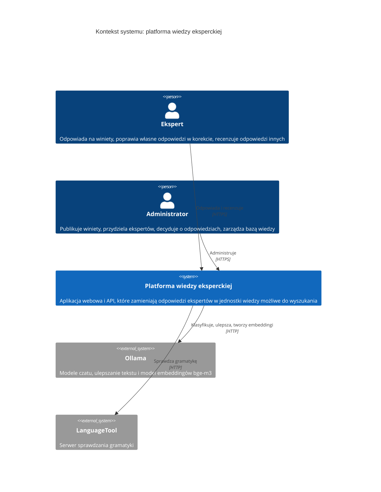
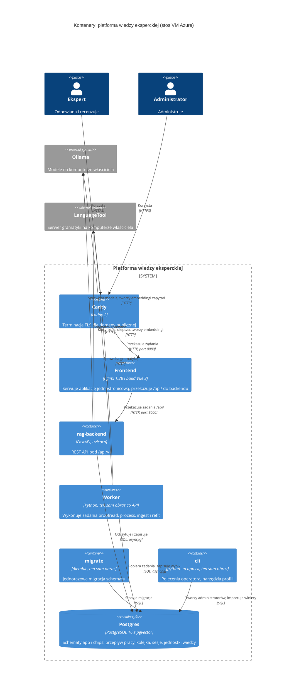
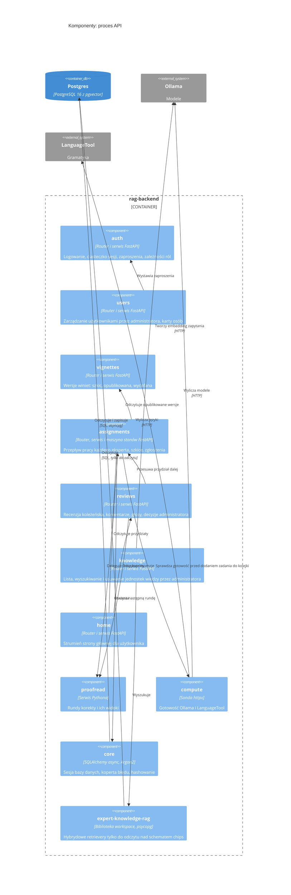
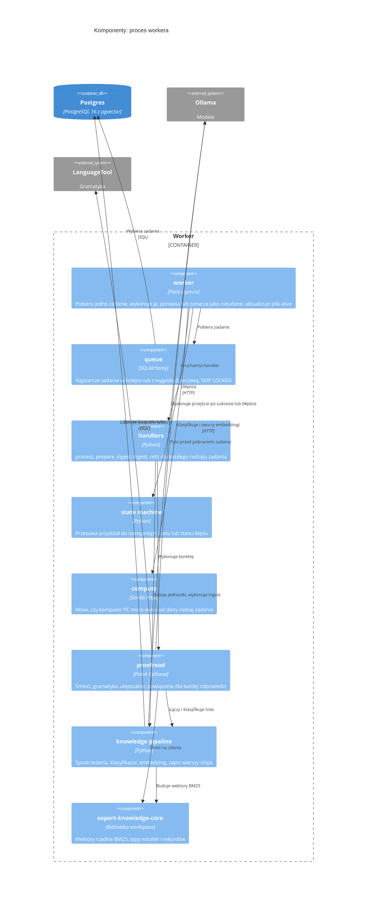
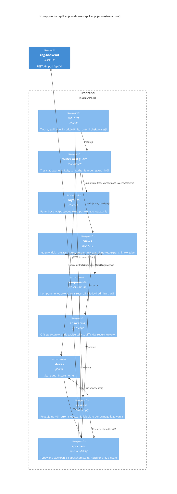

# O architekturze

Język: **Polski** · [English](../../explanation/architecture.md)

System to platforma webowa, która zbiera pisemne odpowiedzi ekspertów na winiety przypadków,
poddaje te odpowiedzi korekcie i recenzji koleżeńskiej, a zatwierdzone zamienia w przeszukiwalne
jednostki wiedzy. Składa się z jednostronicowej aplikacji Vue, backendu FastAPI, workera w tle,
który wykonuje powolne kroki, jednej bazy PostgreSQL oraz dwóch usług uruchamiających modele
językowe i sprawdzanie gramatyki (Ollama i LanguageTool). Strona pokazuje system na trzech
poziomach (kontekst, kontenery, komponenty) i wymienia wartości, które muszą być zgodne między
poszczególnymi częściami.

Diagramy używają modelu C4 zapisanego w Mermaid. Diagram kontenerów odpowiada stosowi z
`infra/azure/docker-compose.yml`; lokalny stos deweloperski z `docker-compose.yml` różni się w
kilku miejscach, które wymienia lista po diagramie.

## Kontekst systemu

Z platformy korzystają dwa rodzaje osób: rola `expert` i rola `admin` (enum `Role`). Eksperci
odpowiadają na przydzielone winiety, sprawdzają wersję po korekcie własnych odpowiedzi i recenzują
odpowiedzi innych. Administratorzy publikują winiety, przydzielają ekspertów, decydują o
zrecenzowanych odpowiedziach, ponawiają nieudane zadania oraz przeszukują i czyszczą bazę wiedzy.
Platforma wywołuje dwie zewnętrzne usługi HTTP: Ollama dla klasyfikatora, modelu ulepszającego
tekst i embeddingów `bge-m3` oraz LanguageTool dla gramatyki. Na maszynie wirtualnej (VM) Azure
obie działają na komputerze właściciela i są dostępne pod `PC_HOST`; w lokalnym stosie compose są
usługami compose.

## Kontenery

Odwiedzający łączy się z Caddy przez HTTPS. Caddy przekazuje całość do kontenera nginx, który
serwuje zbudowaną aplikację jednostronicową i przekazuje ścieżki pod `/api/` do backendu, dzięki
czemu strona i API mają jedno źródło (origin), a ciasteczko sesji nie wymaga CORS. Backend
odpowiada na żądania i zapisuje stan każdego przydziału w Postgresie. Kroki, które trwają długo
(korekta, cięcie odpowiedzi na jednostki, embedding, ponowne dopasowanie indeksu BM25), nie
działają w ramach żądania: maszyna stanów wstawia wiersz do tabeli `jobs`, a worker, drugi proces
z tego samego obrazu, pobiera go, wywołuje Ollama i LanguageTool i zapisuje wynik w tej samej
bazie. Kolejka, sesje i ślad audytowy są tabelami w Postgresie; nie istnieje kontener z brokerem
ani z pamięcią podręczną. `migrate` uruchamia `alembic upgrade head` przed startem API i workera,
a `cli` na żądanie wykonuje `create-admin`, `import-vignettes` i `export-openapi`.

Lokalny stos z `docker-compose.yml` różni się od diagramu w tych miejscach:

- Brak Caddy. Usługa `frontend` to serwer deweloperski Vite na porcie 5173, który przekazuje
  `/api` do `rag-backend:8000`; usługa `frontend-preview` (profil `preview`) uruchamia
  produkcyjny obraz nginx na porcie 8080.
- `ollama` i `languagetool` są usługami compose, a nie zewnętrzną maszyną.
- Plik compose uruchamia też MinIO (bucket i użytkownika aplikacji tworzy `minio-init`), pgAdmin
  (profil `tools`), przeglądarkę Playwright MCP (profil `browser`) i przestrzeń roboczą `dev`.
  Kod backendu w `backend/app` nie ma klienta S3; klient S3 jest w `scripts/corpus/storage.py`,
  więc MinIO należy do skryptów korpusu, a nie do diagramu platformy webowej.
- Postgres przy pierwszym starcie wykonuje `backend/db/init.sql`, który tworzy tabele
  `public.documents` i `public.chunks` dla korpusu literatury. Stos VM nie montuje tego pliku.

## Komponenty: backend

API i worker to jeden pakiet Pythona, `backend/app`, uruchamiany dwoma poleceniami
(`uvicorn app.main:app` i `python -m app.jobs.worker`). Dwa kolejne diagramy dzielą go według
procesów.

`app/main.py` montuje siedem routerów pod `/api/v1`: auth, users, vignettes, assignments,
reviews, knowledge i home, a ponadto trasę `/health`. Każdy router importuje zależności ról z
`auth` (`CurrentUser`, `AdminUser`), dlatego diagram nie rysuje dla nich strzałki. Komponent
`assignments` zawiera maszynę stanów; jej funkcja `transition()` jest jedynym zapisującym
`Assignment.state`, zapisuje zdarzenie audytu i wstawia wiersz `Job` dla stanu wykonywanego przez
workera. `reviews` i `home` odczytują te same wiersze przydziałów i sterują nimi, a ekrany korekty
przydziału serwuje `proofread` przez router assignments. Gdy `REQUIRE_COMPUTE` jest włączone,
lifespan aplikacji uruchamia `compute.watch()`, które co dziesięć sekund sprawdza Ollama i
LanguageTool, a żądanie, które dodałoby zadanie do kolejki, dostaje 503, jeśli ostatnia sonda nie
znalazła wymaganego modelu lub LanguageTool. Wyszukiwanie wiedzy to jedyna ścieżka API, która
używa retrieverów `expert-knowledge-rag`: tworzą one embedding zapytania przez Ollama i czytają
schemat `chips` przez połączenie psycopg tylko do odczytu.

Worker importuje `app.models`, żeby znać każdą tabelę bez uruchamiania API. `run_once()` pobiera
jedno zadanie, wykonuje powolne przygotowanie (`PREPARE`: korekta lub embedding) bez blokady, a
następnie wykonuje handler i przejście stanu w jednym commicie pod blokadą wiersza przydziału.
Zadanie, które kończy się trwałym błędem lub błędem w ostatniej próbie, przesuwa przydział do
stanu `*_failed`; ponowienie przez administratora kolejkuje je od nowa. Potok `proofread` łączy
w łańcuch usuwanie śmieci, LanguageTool, model ulepszający tekst, ponownie LanguageTool i układ.
`knowledge pipeline` tnie zatwierdzone odpowiedzi na jednostki fragmentów i przypadków,
przypisuje niecytowane zdania za pomocą modelu klasyfikatora, tworzy embeddingi tekstów jednostek
modelem `bge-m3`, zapisuje wiersze `chips` w jednej transakcji pod blokadą doradczą (advisory
lock) i dopasowuje BM25 ponownie na całym korpusie. Stany opisuje strona
[Cykl życia przydziału](assignment-lifecycle.md), a jednostki i indeks strona
[Wyszukiwanie i indeksowanie](retrieval-and-indexing.md).

## Komponenty: aplikacja webowa

`frontend/src/main.ts` montuje aplikację z Pinią, routerem i obsługą sesji. Router
(`frontend/src/router/index.ts`) ładuje leniwie każdy widok oprócz powłoki chronionej logowaniem
`AppLayout` i `HomeView`; przed każdą nawigacją pyta store `auth` o bieżącego użytkownika
(`GET /api/v1/me`), a `guardRoute` stosuje metadane tras `requiresAuth`, `guestOnly` i `roles`.
Widoki renderują komponenty i wywołują klienta API bezpośrednio albo przez store `auth` i `home`;
helpery `answering` zawierają czystą logikę cytatów i szkiców. Klient
(`frontend/src/api/client.ts`) powstaje z typów w `src/api/schema.d.ts`, które generuje
`npm run gen:api` z `frontend/openapi.json`; `python -m app.cli export-openapi` zapisuje ten
dokument OpenAPI. Klient używa `window.location.origin` jako adresu bazowego i zamienia każdą
odpowiedź spoza zakresu 2xx na `ApiError`; 401 wywołuje handler zainstalowany przez `session.ts`,
który odsyła użytkownika na stronę logowania albo, na trasie oznaczonej `keepOnExpiry` (strony
odpowiadania i recenzji), prosi o hasło nad stroną. Katalog komponentów znajduje się w
[Komponenty frontendu](../reference/frontend-components.md).

## Ograniczenia i kompromisy

- **Jedna baza danych przechowuje cały stan.** Przydziały, kolejka zadań, sesje, zdarzenia audytu,
  winiety i zaingestowane jednostki wiedzy to tabele jednej instancji Postgresa w dwóch
  schematach: `app` (modele SQLAlchemy, autogenerowanie Alembic) i `chips` (tworzony migracją 0003
  zwykłym SQL, zapisywany surowym SQL w `knowledge/ingest.py` i czytany przez
  `expert-knowledge-rag`). Jedynym wolumenem z danymi aplikacji na VM jest `postgres-data`;
  `infra/azure/backup.sh` zapisuje codzienny `pg_dump` tego wolumenu i przechowuje siedem dni.
- **API i worker muszą uruchamiać ten sam kod i te same ustawienia.** Oba startują z jednego
  obrazu (`infra/backend.Dockerfile`) z tym samym blokiem zmiennych środowiskowych i oba czytają
  `prompts/` i `config/` względem `settings.project_root`. Worker potrzebuje `prompts/` i
  `config/` obok `backend/`, które kopiuje Dockerfile, a lokalny plik compose montuje.
- **Model embeddingów i rozmiary muszą się zgadzać wszędzie.** `bge-m3` z 1024 wymiarami jest
  ustawiony w `config/indexing.yaml` i w `expert_knowledge_core/retrieval.py`; embedder sprawdza
  wyjście modelu względem `embeddings.dimensions`, a `ExpertKnowledgeStore` sprawdza szerokość
  zapytania. Przestrzeń haszy BM25 `1 << 20` jest równa kolumnom `sparsevec(1048576)`, a blok
  `sparse` w `config/indexing.yaml` jest równy domyślnym wartościom `Bm25Config`.
- **Modele muszą istnieć na maszynie z Ollama.** Przy `REQUIRE_COMPUTE` rodzaj zadania jest gotowy
  tylko wtedy, gdy Ollama wyświetla modele, których potrzebuje (`CLASSIFIER_MODEL`, niepusty
  `ENHANCE_MODEL` albo model embeddingów z `config/indexing.yaml`) i, dla korekty, LanguageTool
  odpowiada. W przeciwnym razie API odrzuca żądanie z 503 `compute_unavailable`, a worker
  zostawia zadanie w kolejce. Stos VM ustawia `REQUIRE_COMPUTE` na `"true"`.
- **Ścieżki i porty warstwy webowej są zgodne.** Prefiks API to `/api/v1`
  (`backend/app/main.py`); nginx i serwer deweloperski Vite przekazują `/api`; Caddy przekazuje do
  `frontend:8080`, czyli do `PORT` nginx; `API_UPSTREAM_URL` to `http://rag-backend:8000`, a
  `API_HOST` to jego nazwa hosta. Rozbieżność w którymkolwiek z nich psuje konfigurację ciasteczka
  w tym samym źródle.
- **Ciasteczko sesji zależy od środowiska.** Ciasteczko nazywa się `session`, a
  `ENVIRONMENT=production` (domyślne na VM) wymusza atrybut secure.
- **Worker zgłasza stan przez plik.** Co dziesięć sekund aktualizuje `/tmp/worker-alive`, a
  sprawdzenie stanu na VM kończy się niepowodzeniem, gdy plik jest starszy niż sześćdziesiąt
  sekund; `deploy.sh` czeka na stan zdrowy kontenerów `rag-backend`, `worker` i `frontend`.
- **Rozmiar VM wyznaczają limity.** `infra/azure/docker-compose.yml` ustawia limity pamięci
  sumujące się do około 2 GB oraz Postgres z `max_connections=30`.

## Powiązane strony

- [Indeks dokumentacji](../index.md)
- [Cykl życia przydziału](assignment-lifecycle.md)
- [Wyszukiwanie i indeksowanie](retrieval-and-indexing.md)
- [Rdzeń API backendu](../reference/backend-core-api.md)
- [Przydziały i zadania w backendzie](../reference/backend-assignments-jobs.md)
- [Recenzje w backendzie](../reference/backend-reviews.md)
- [Winiety i wiedza w backendzie](../reference/backend-vignettes-knowledge.md)
- [Indeksowanie i korekta w backendzie](../reference/backend-indexing-proofread.md)
- [Pakiety](../reference/packages.md)
- [Chunking](../reference/chunking.md)
- [Aplikacja frontendu](../reference/frontend-app.md)
- [Komponenty frontendu](../reference/frontend-components.md)
- [Środowisko uruchomieniowe i wdrożenie](../reference/runtime-and-deploy.md)

## Źródła w kodzie

- `docker-compose.yml` - lokalne usługi, profile, porty, środowisko, zależności między usługami
- `infra/azure/docker-compose.yml` - kontenery VM, wspólne środowisko backendu, sprawdzenia stanu, limity, profil tools
- `infra/azure/Caddyfile` - reverse proxy Caddy do kontenera frontendu
- `infra/azure/env.example` - zmienne VM, takie jak host PC i środowisko
- `infra/azure/backup.sh` - codzienny pg_dump bazy danych
- `infra/azure/deploy.sh` - oczekiwanie na zdrowe kontenery
- `.github/workflows/deploy.yml` - obrazy budowane z dwóch Dockerfile w infra
- `backend/Dockerfile` - lokalny obraz backendu, kopie prompts i config
- `infra/backend.Dockerfile` - produkcyjny obraz backendu i polecenie uvicorn
- `infra/frontend.Dockerfile` - produkcyjny obraz frontendu z nginx
- `frontend/nginx/default.conf.template` - proxy /api/, trasa health, fallback aplikacji jednostronicowej
- `frontend/vite.config.ts` - proxy /api serwera deweloperskiego
- `frontend/package.json` - skrypt gen:api i zależności frontendu
- `frontend/openapi.json` - dokument OpenAPI, z którego generowane są typy
- `backend/app/main.py` - zamontowane routery, prefiks API, lifespan z watcherem compute
- `backend/app/cli.py` - polecenia create-admin, export-openapi i import-vignettes
- `backend/app/settings.py` - ustawienia, katalog główny projektu, pola środowiska i ciasteczka
- `backend/app/compute.py` - sondy Ollama i LanguageTool, gotowość dla każdego rodzaju zadania
- `backend/app/core/db.py` - silnik async, schemat app, URL bazy danych
- `backend/app/auth/router.py` - zależności ról i trasy ciasteczka sesji
- `backend/app/auth/service.py` - nazwa ciasteczka sesji i flaga secure
- `backend/app/auth/dependencies.py` - CurrentUser i AdminUser
- `backend/app/users/router.py:6,40,61` - router users importuje i wywołuje issue_invite z serwisu auth
- `backend/app/users/service.py:11` - tworzenie i aktualizacja użytkowników oraz karty osób; importuje end_all_sessions z serwisu auth
- `backend/app/assignments/router.py` - trasy delegujące do proofread
- `backend/app/assignments/service.py` - użycie winiet
- `backend/app/assignments/state_machine.py` - jedyny zapisujący stan, kolejkowanie zadań, bramka compute
- `backend/app/reviews/service.py` - użycie przydziałów, proofread i knowledge
- `backend/app/home/service.py` - odczyty przydziałów, recenzji i zadań
- `backend/app/knowledge/router.py` - trasy administratora dla wiedzy
- `backend/app/knowledge/search.py` - użycie retrieverów i połączenia tylko do odczytu
- `backend/app/knowledge/embedding.py` - embedder z konfiguracji, sprawdzenie wymiarów
- `backend/app/knowledge/ingest.py` - surowy SQL do schematu chips, blokada doradcza, ponowne dopasowanie BM25
- `backend/app/jobs/worker.py` - pętla workera, plik alive, przejścia, sprawdzenie compute
- `backend/app/jobs/handlers.py` - handlery i kroki prepare dla każdego rodzaju zadania
- `backend/app/jobs/queue.py` - zapytanie pobierające zadanie
- `backend/app/proofread/pipeline.py` - łańcuch korekty
- `backend/app/proofread/grammar.py` - klient LanguageTool
- `backend/app/proofread/enhance.py` - wywołanie ulepszania w Ollama
- `backend/app/proofread/links.py` - powiązania i użycie klasyfikatora
- `backend/app/ollama.py` - klient czatu Ollama
- `backend/app/embeddings.py` - klient embeddingów Ollama
- `backend/migrations/env.py` - Alembic zarządza tylko schematem app
- `backend/db/init.sql` - tabele public tworzone przez lokalny kontener Postgres
- `config/indexing.yaml` - model embeddingów, wymiary, parametry BM25
- `packages/expert-knowledge-core/src/expert_knowledge_core/retrieval.py` - stałe modelu embeddingów i wymiarów
- `packages/expert-knowledge-core/src/expert_knowledge_core/bm25.py` - rozmiar przestrzeni haszy
- `packages/expert-knowledge-rag/src/expert_knowledge_rag/store.py` - store tylko do odczytu, schemat chips, sprawdzenie szerokości
- `scripts/corpus/storage.py` - klient S3 używany przez skrypty korpusu
- `frontend/src/main.ts` - start aplikacji
- `frontend/src/router/index.ts` - trasy, leniwe ładowanie, wywołanie guard
- `frontend/src/router/guard.ts` - sprawdzanie metadanych tras
- `frontend/src/api/client.ts` - typowany klient, ApiError, handler 401
- `frontend/src/session.ts` - obsługa 401
- `frontend/src/stores/auth.ts` - wywołania store auth
- `frontend/src/stores/home.ts` - wywołania store home
- `frontend/src/layouts/AppLayout.vue` - layout, store'y i okno ponownego logowania
- `frontend/src/views/AnswerView.vue` - widoki importujące komponenty, helpery answering i store
