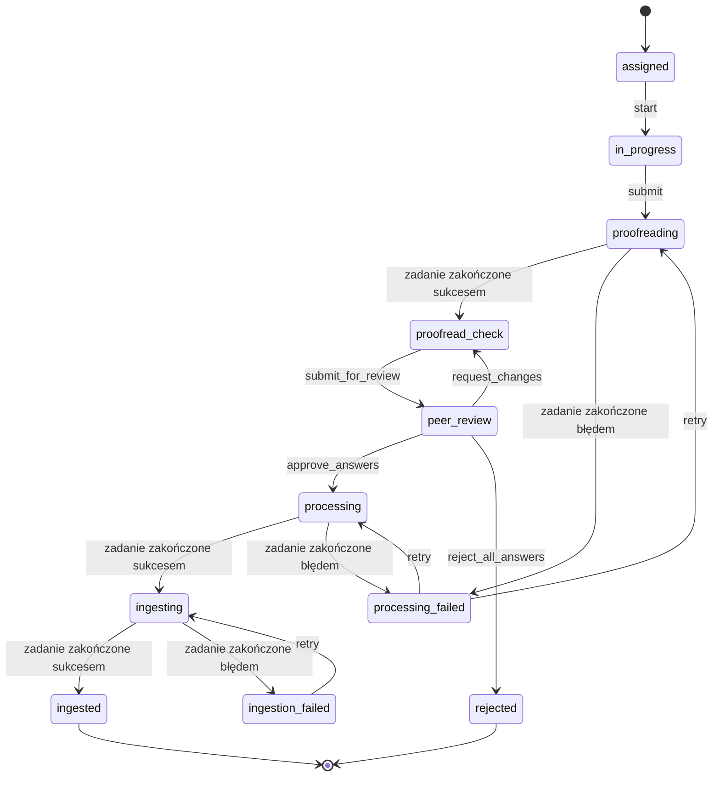

# O cyklu życia przydziału

Język: **Polski** · [English](../../explanation/assignment-lifecycle.md)

Przydział to jeden ekspert odpowiadający na jedną opublikowaną wersję winiety. Jego życie biegnie od przydzielenia przez administratora, przez odpowiadanie, korektę, recenzję koleżeńską i przetwarzanie, do ingestu zatwierdzonych odpowiedzi jako jednostek wiedzy albo do odrzucenia lub anulowania. Strona wyjaśnia, jak współgrają elementy, które prowadzą przydział przez ten cykl, i dlaczego mają taki kształt: jedna maszyna stanów, kolejka zadań oparta na Postgresie, która wykonuje wolną pracę, oraz recenzja, którą zamyka wyłącznie administrator. Tabele stanów, tras i stałych są w [backend-assignments-jobs.md](../reference/backend-assignments-jobs.md) i [backend-reviews.md](../reference/backend-reviews.md); nie są tu powtarzane.

## Jak to się składa w całość

### Jeden zapisujący stan

`Assignment.state` ma jednego zapisującego, `transition()` w `state_machine.py`. Tabela przejść odwzorowuje parę (stan, akcja) na stan docelowy i aktorów uprawnionych do wykonania przejścia, więc niedozwolony ruch i ruch wykonany przez niewłaściwego aktora są odrzucane w jednym miejscu (409 `illegal_transition`, 403 `forbidden`). To samo wywołanie zapisuje zdarzenie audytu i, gdy stan docelowy ma zadanie, dodaje wiersz `Job`. Wywołujący trzyma blokadę wiersza przydziału i zatwierdza transakcję, więc zmiana stanu, jej zdarzenie audytu i zakolejkowane zadanie trafiają do bazy razem albo wcale.

Zdarzenia audytu tworzą oś czasu przydziału. Są pokazywane w dwóch widokach: administrator widzi aktora i metadane każdego zdarzenia, a autor widzi rolę (`you`, `admin`, `reviewer`, `system`) i nie widzi zdarzeń dyskusji (`review_opened`, `comment_added`, `vote_cast`), ponieważ oś czasu autora służy przepływowi pracy.

Diagram pokazuje przejścia z `TRANSITIONS`, z pominięciem `cancel`: administrator może anulować z `assigned`, `in_progress`, `proofread_check` i `peer_review`, a `cancelled` jest trzecim stanem końcowym obok `ingested` i `rejected`. Anulowany przydział jest pomijany w unikalnym indeksie na (version, expert), więc ekspert może dostać tę samą wersję ponownie.

### Jedne stany przesuwają ludzie, inne workery

Stany dzielą się na dwie grupy. W `assigned`, `in_progress`, `proofread_check` i `peer_review` przydział czeka na człowieka: autora, recenzenta lub administratora. W `proofreading`, `processing` i `ingesting` (`JOB_STATES`) pracuje zadanie w tle, a przydział czeka na workera; komentarz w `states.py` odnotowuje, że frontend odpytuje serwer, dopóki widzi jeden z tych stanów, a `AssignmentSummary.job_running` udostępnia ten sam fakt. Stany błędu, `processing_failed` i `ingestion_failed`, czekają na administratora.

Wejście w stan zadania kolejkuje zadanie tego stanu (`JOB_ON_ENTRY`). Gdy worker kończy pracę, wywołuje `transition` jako aktor `system` z pasującą akcją sukcesu albo z akcją błędu. Akcje sukcesu i błędu nie należą do nazw, które użytkownik widzi w `allowed_actions`, więc stan przesuwa albo człowiek przez trasę, albo worker.

### Kolejka i worker

Kolejką jest tabela `jobs`. Proces workera (`python -m app.jobs.worker`) pobiera najstarsze zadanie `queued` albo zadanie `running` z wygasłą dzierżawą, używając `FOR UPDATE SKIP LOCKED`, więc kilka workerów działa równolegle bez brania tego samego zadania. Częściowy indeks unikalny dopuszcza co najwyżej jedno żywe zadanie na przydział i rodzaj. Worker trzyma zadanie przez dzierżawę, a nie przez połączenie: heartbeat odnawia dzierżawę, gdy zadanie trwa, więc długie zadanie nie jest przejmowane, a zadanie workera, który uległ awarii, jest przejmowane po upływie jednej dzierżawy. Zadanie, którego worker zginął po wykorzystaniu wszystkich prób, kończy się błędem `LeaseExpired`.

Wolna praca jest oddzielona od zapisu wyniku. Każdy rodzaj zadania ma opcjonalny krok `PREPARE` (korekta i embedding używają modeli i sieci), który działa bez otwartej transakcji i bez blokady wiersza, oraz `HANDLER`, który zapisuje wynik pod blokadą przydziału w tej samej transakcji co przejście sukcesu. Handler działa tylko wtedy, gdy zadanie jest bieżącą próbą (`_current`), więc worker, któremu dzierżawę przejęto, nie może zapisać nieaktualnego wyniku. Cięcie odpowiedzi na jednostki nie ma kroku przygotowania: nie wywołuje żadnego modelu.

Zadanie, które się nie powiodło, jest ponawiane do `MAX_ATTEMPTS` razy. `PermanentJobError` (brak materiału do zbudowania, brak jednostek, jednostki bez tekstu nadającego się do embeddingu) kończy zadanie błędem od razu. Gdy wyjątek zgłoszono, bo maszyna hostująca modele nie działa, zadanie wraca do kolejki bez zużycia próby. Zadanie zachowuje tylko klasę wyjątku jako `last_error`, ponieważ komunikaty mogłyby cytować tekst eksperta. Po ostatniej porażce przydział przechodzi do stanu błędu swojego zadania.

Porażki `proofread` i `process` prowadzą do `processing_failed`, więc ten stan jest wspólny dla dwóch zadań. `retry` administratora patrzy zatem na ostatnie nieudane zadanie przydziału i wybiera akcję ponowienia właściwą jego rodzajowi. Worker sam nie ponawia ponad `MAX_ATTEMPTS`; robi to administrator.

Trzeci rodzaj zadania, `refit`, nie ma przydziału. Dopasowuje na nowo indeks rzadki po usunięciu jednostek wiedzy, bierze blokadę doradczą (advisory lock) i nie przesuwa żadnego przepływu, dlatego `assignment_id` jest nullowalne.

### Bramka obliczeniowa

Modele do korekty i embeddingu mogą działać na innej maszynie niż API (`app/compute.py`). Gdy `REQUIRE_COMPUTE` jest włączone, sprawdzają to dwa miejsca. API sprawdza przed akcją użytkownika, która wchodzi w stan zadania, i odpowiada 503 `compute_unavailable` zamiast kolejkować zadanie, które nie może się wykonać; zatwierdzenie odpowiedzi sprawdza też model embeddingu, ponieważ ingest następuje po przetwarzaniu bez człowieka pomiędzy nimi (`FOLLOWED_BY`). Worker sprawdza przed pobraniem zadania, więc zadanie, którego maszyna nie działa, czeka w kolejce, a pozostałe się wykonują. API czyta ostatnią sondę odnawianą przez zadanie w tle, więc żadne żądanie nie czeka na sieć, trzymając blokadę wiersza. Ruchy samego workera nie są sprawdzane w `transition`.

### Odpowiadanie i składanie

Szkic eksperta żyje w `answer_drafts`, osobno od wiersza przydziału, ponieważ autozapis go nadpisuje. Każdy zapis niesie wersję, na której się opiera; nieaktualna wersja daje 409 `draft_conflict`, co chroni przed drugą kartą przeglądarki. Zapis szkicu jest pobłażliwy co do kompletności, aby na pytania można było odpowiadać w dowolnej kolejności; złożenie sprawdza wszystko. Zgłoszenie to osobny wiersz `submissions`, zamrożony (docstring modelu mówi, że trigger bazy danych odrzuca aktualizacje), i zapisuje hash wersji winiety, do której odnoszą się odpowiedzi.

### Korekta i sprawdzenie przez autora

Złożenie kolejkuje zadanie `proofread`. Jego przygotowanie koryguje każdą napisaną odpowiedź i łączy każde przypisane zdanie z cytatami, które zrobił autor; jego handler zapisuje wynik jako rundę korekty dla bieżącego `review_round` przydziału. Sprawdzanie gramatyki i model są w potoku opcjonalne: niedostępny element pomija swój przebieg i odnotowuje to, chyba że `REQUIRE_COMPUTE` jest włączone, wtedy zadanie kończy się błędem i czeka na maszynę, zamiast oddać autorowi niesprawdzoną odpowiedź.

W `proofread_check` autor edytuje poprawiony tekst i powiązania. Przekazanie do recenzji wymaga, aby każda odpowiedź była niepusta, a każda linia przypisanej odpowiedzi była powiązana z cytatem albo z przypadkiem. Ustawienie `submitted_at` na rundzie to sposób, w jaki kod recenzji rozpoznaje, że runda została złożona.

### Recenzja koleżeńska

Przeczytanie odpowiedzi koleżanki lub kolegi wpływa na własne odpowiedzi, a kod traktuje to jako centralne ograniczenie recenzji. Każdy aktywny ekspert może czytać zgłoszenie w recenzji, z wyjątkiem jego autora i każdego, kto musi jeszcze odpowiedzieć na winietę (na dowolnej wersji). Reguła jest sprawdzana przy każdym żądaniu, zamiast być ustalana w chwili złożenia, więc ekspert, który dołącza później, również widzi recenzję. Czytanie jest jawne: recenzent otwiera recenzję, zanim serwer wyśle jakikolwiek tekst, a utworzony wtedy wiersz `review_participants` wyklucza go z późniejszego przydziału tej winiety (`reviewer_contaminated`). `GET` sam z siebie nigdy więc nie powoduje wykluczenia.

Recenzenci i inne osoby dyskutują i głosują, ale decyzja należy do administratora. Głosy mają charakter doradczy i można je zmieniać do zamknięcia recenzji. Głos niesie rundę, na którą patrzył recenzent, a głos na odpowiedź, która od tego czasu została zmieniona, jest odrzucany (`stale_round`), zamiast trafić na tekst, którego nikt nie czytał. Komentarzy nigdy się nie edytuje, ponieważ decyzje opierają się na tym, co powiedziano. Stanowisko wobec komentarza zajmują tylko recenzenci, bo autor opowiadający się po jednej ze stron wobec własnej pracy byłby głosem na nią.

Administrator decyduje o każdej odpowiedzi dokładnie raz. Zatwierdzenie jest zapisywane z hashem zrecenzowanego tekstu i powiązań, więc dotyczy dokładnie tego tekstu. Pojedyncze `request_changes` odsyła wszystkie odpowiedzi: `review_round` rośnie, przydział wraca do `proofread_check`, a nowa runda kopiuje tekst, powiązania i flagi poprzedniej rundy, z komentarzami administratora jako informacją zwrotną. Komentarze i głosy następnej recenzji należą do nowej rundy. Bez próśb o zmiany zatwierdzone odpowiedzi trafiają do `processing`; jeśli żadna zatwierdzona odpowiedź nie jest taką, którą tnie się na jednostki, zgłoszenie jest `rejected`. Na jednostki tnie się tylko pytania otwarte inne niż Q4; wyjaśnienie Q4 i ocena nie są cięte.

### Przetwarzanie i ingest

Zadanie `process` buduje rekord findings ze zgłoszenia i z końcowych linii zatwierdzonych odpowiedzi, zapisuje jednostki wiedzy ze statusem `approved`, a przejście przenosi przydział do `ingesting`. Według docstringu handlera nikt nie czyta jednostek przed ingestem. Zadanie `ingest` liczy embeddingi jednostek w swoim przygotowaniu, następnie zapisuje je w tabelach wyszukiwania i ustawia ich status na `ingested`, a przydział osiąga stan końcowy `ingested`. Administrator może sprawdzić, jak zatwierdzone odpowiedzi zostały przypisane, w widoku findings, którego autor nigdy nie widzi.

## Ograniczenia i kompromisy

- Stan, zdarzenie audytu i zadanie są zapisywane w jednej transakcji pod blokadą wiersza. Koszt to to, że każda trasa zmieniająca przydział najpierw blokuje jego wiersz, a worker bierze tę samą blokadę, w tej samej kolejności, zarówno na ścieżce sukcesu, jak i błędu.
- Wolna praca odbywa się poza jakąkolwiek blokadą. Koszt to to, że wynik może należeć do zadania, które utraciło dzierżawę, co sprawdza `_current`, oraz że krok `PREPARE` może wykonać się ponownie po ponowieniu; korekta zastępuje rundę, którą zapisała w poprzedniej próbie.
- Stan `processing_failed` jest wspólny dla dwóch rodzajów zadań. Koszt to to, że jego znaczenie odczytuje się z tabeli zadań.
- Dostęp do recenzji jest oceniany przy każdym żądaniu, a czytanie jest zapisywane jawnie. Koszt to dodatkowy krok `review/open` dla recenzentów oraz to, że ekspertowi, który otworzył recenzję winiety, nie można przydzielić tej winiety.
- Zatwierdzenie jest związane z hashem treści, a głos z rundą. Koszt to to, że edycja po prośbie o zmiany rozpoczyna dyskusję i głosowanie od początku w nowej rundzie.
- Liczba recenzentów na przydział nie jest ograniczona w przejrzanych modułach.

## Powiązane strony

- [Przydziały i zadania (reference)](../reference/backend-assignments-jobs.md)
- [Recenzje (reference)](../reference/backend-reviews.md)
- [Indeksowanie i korekta (reference)](../reference/backend-indexing-proofread.md)
- [Winiety i wiedza (reference)](../reference/backend-vignettes-knowledge.md)
- [Podstawowe API (reference)](../reference/backend-core-api.md)
- [Architektura](architecture.md)
- [Indeks dokumentacji](../index.md)

## Źródła w kodzie

- `backend/app/assignments/state_machine.py` - tabela przejść, jeden zapisujący, kolejkowanie zadań, sprawdzenie maszyny obliczeniowej
- `backend/app/assignments/states.py` - stany, stany zadań, stany końcowe i komentarz o odpytywaniu
- `backend/app/assignments/service.py` - przydzielanie, sprawdzenie skażenia, szkice, złożenie, ponowienie, widoki osi czasu
- `backend/app/assignments/models.py` - tabele szkiców i zgłoszeń, częściowy indeks unikalny aktywnych przydziałów
- `backend/app/assignments/answers.py` - pobłażliwe sprawdzenia szkiców i ścisłe sprawdzenia złożenia
- `backend/app/jobs/queue.py` - zapytanie pobierające, dzierżawa i próby
- `backend/app/jobs/worker.py` - podział prepare/handler, heartbeat, ścieżki ponowienia i błędu
- `backend/app/jobs/handlers.py` - handlery process, ingest i refit, tabele PREPARE i HANDLERS
- `backend/app/jobs/models.py` - tabela zadań, indeks unikalny żywych zadań, uzasadnienie last_error
- `backend/app/jobs/errors.py` - błędy trwałe
- `backend/app/reviews/service.py` - otwieranie, komentarze, głosy, decyzje i rundy
- `backend/app/reviews/access.py` - kto może czytać recenzję i dlaczego
- `backend/app/reviews/models.py` - uczestnicy, komentarze, głosy, decyzje i ich uzasadnienie
- `backend/app/proofread/service.py` - zadanie korekty, sprawdzenie przez autora, przekazanie do recenzji, następna runda
- `backend/app/proofread/pipeline.py:1-30` - opcjonalne przebiegi i wyjątek REQUIRE_COMPUTE
- `backend/app/compute.py` - sonda i jej użycie przez API i workera
- `backend/app/knowledge/findings.py:76-79` - które odpowiedzi są cięte na jednostki
