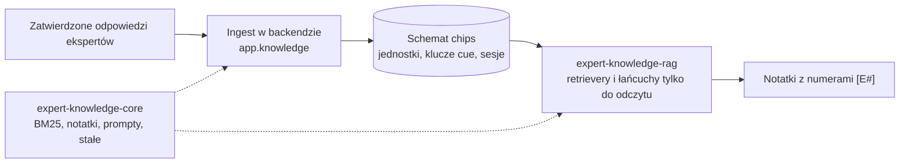

# O wyszukiwaniu i indeksowaniu

Język: **Polski** · [English](../../eng/explanation/retrieval-and-indexing.md)

System przechowuje jeden przeszukiwalny magazyn wiedzy eksperckiej w Postgresie, schemat `chips`, i łączy w nim gęsty embedding bge-m3 z rzadkim wektorem BM25. Backend webowy zapisuje do `chips` zatwierdzone spostrzeżenia ekspertów. Kod BM25, pakowanie notatek i stałe wyszukiwania znajdują się w niezależnym od frameworków pakiecie `expert-knowledge-core`, więc ingest i wyszukiwanie używają jednej kopii; pakiet `expert-knowledge-rag` czyta `chips` przez połączenie tylko do odczytu. Strona wyjaśnia, dlaczego części mają taki kształt. Listy nazw, sygnatur i wartości domyślnych są w [Pakiety](../reference/packages.md).

## Jak to się łączy

Backend zapisuje jednostki, klucze cue i sesje oraz dopasowuje na nich BM25. Linie przerywane pokazują ponowne użycie kodu pakietu core; `expert-knowledge-rag` odpytuje `chips` i zwraca notatki, które jego łańcuchy przekazują modelowi czatu. Skrypty ewaluacyjne w `scripts/rag/` używają tego samego embeddera zapytań i ustawień BM25 przez `rag_common.py`, który czyta `config/indexing.yaml`.

### Indeksowanie: gęsty i rzadki w jednym wierszu

Wektor gęsty to embedding bge-m3 tekstu jednostki (kolumny `vector(1024)` w `chips`). Wektor rzadki zawiera wagi BM25, tak że zwykły iloczyn skalarny między zapisanym wektorem a wektorem zapytania jest równy wynikowi BM25. Dzięki temu jedna kolumna pgvector i jeden operator (`<#>`, ujemny iloczyn skalarny) wyrażają BM25 wewnątrz Postgresa. Terminy są haszowane do 2^20 wymiarów, więc nie istnieje tabela słownika; kolizja haszy tylko łączy dwa terminy (docstring `bm25.py`). Migracja 0003 tworzy kolumny `sparsevec(1048576)` bez indeksu wektorowego, więc wyszukiwanie jest dokładnym skanem.

BM25 potrzebuje statystyk całego korpusu (`idf` i średnia długość dokumentu). Dlatego backend dopasowuje wektory rzadkie od nowa na całości `chips` po ingeście (`refresh_sparse` w `ingest.py`). Zmiana ustawień BM25 wymaga ponownego dopasowania, ale nie nowego embeddingu, ponieważ wektor gęsty nie zależy od ustawień rzadkich.

### Wyszukiwanie: ranking, fuzja i notatki

Wyszukiwanie szereguje kandydatów dwa razy, raz według gęstej odległości cosinusowej i raz według BM25, a oba rankingi łączy fuzją rang (reciprocal rank fusion): wynik elementu to suma `1 / (RRF_K + rank)` po rankingach. Fuzja działa na rangach, więc nie potrzebuje wspólnej skali dla wartości cosinusowych i BM25. Wiersz, który nie ma wspólnego terminu z zapytaniem, ma wynik BM25 równy 0 i nie jest trafieniem w rankingu rzadkim. Zapytanie złożone wyłącznie ze stopwords nie ma wektora rzadkiego, więc wyszukiwanie hybrydowe wraca do samego rankingu gęstego.

Magazyn ekspertów przechowuje jednostki spostrzeżeń: po jednej na każde ukierunkowane zaznaczenie oraz jedną dla zdań o przypadku jako całości. Każda jednostka ma jeden osadzany tekst, `i1` (tekst po recenzji), z wektorem gęstym i rzadkim; słowa pacjenta są osadzane osobno jako klucze cue. Pytania przeszukują `i1`. Do tego magazynu prowadzą dwa retrievery:

- `ExpertQuestionRetriever` przeszukuje jednostki pytaniem klinicysty.
- `PatientTextRetriever` dzieli tekst pacjenta na zdania, szereguje klucze cue (słowa pacjenta, które eksperci zaznaczyli) dla każdego zdania, łączy rankingi zdań i szereguje jednostki według wyniku ich własnego cue plus bonusu za pozostałe cue cytowane razem z nim. Kombinacja słów pacjenta wyprzedza więc pojedyncze słowo.

Ogólne odpowiedzi o przypadku jako całości powtarzają się w sesjach i zapełniałyby wynik ogólnego pytania. Retriever pytań przesuwa na koniec jednostkę przypadku, która jest prawie duplikatem (cosinus co najmniej `NEAR_DUPLICATE`) lepiej uszeregowanej jednostki przypadku.

Trafienie nie jest zwracane jako surowy wiersz. Retrievery ładują rekord spostrzeżeń sesji i pakują jednostki w notatkę: wiersz przypadku, słowa pacjenta ze znacznikami kierunku od eksperta oraz własne zdania eksperta, każde raz, z chipami cytatów wyrenderowanymi jako krótkie cytaty. Jednostki jednej sesji, które mają wspólne zdanie, są łączone w jedną notatkę, więc zdanie się nie powtarza. Łańcuchy numerują notatki `[E1]`, `[E2]` i tak dalej, a ewaluowane prompty systemowe proszą model o ich cytowanie. Gdy nie znaleziono żadnej notatki, łańcuchy odpowiadają `NOT_IN_SOURCES` i nie wywołują modelu: bez notatek model odpowiada z wiedzy ogólnej, czemu łańcuchy mają zapobiegać (docstring `chains.py`).

## Dlaczego `expert-knowledge-core` jest niezależny od frameworków

Pakiet core zawiera to, w czym ingest backendu webowego i pakiet wyszukiwania muszą się zgadzać: wektory rzadkie BM25, notatki, rekord spostrzeżeń, prompty i stałe wyszukiwania. Nie ma w nim LangChain, frameworka webowego ani sterownika bazy danych (docstring `__init__.py`; zależności w `pyproject.toml` to pydantic, pgvector i snowballstemmer).

Każdy z tych elementów musi być identyczny po obu stronach. Zapytanie musi być tokenizowane dokładnie tak jak zapisane wektory, inaczej wagi BM25 i terminy zapytania się nie spotkają. Tekst, z którego utworzono embedding, i tekst pakowany do notatki muszą pozostawać zsynchronizowane (docstring `notes.py`). Rekord zapisywany przez ingest musi być rekordem czytanym przez wyszukiwanie, czego pilnuje `FINDINGS_VERSION`: rekord z inną wersją nie jest czytany. Docstring pakietu podaje jako jego cel to, w czym ingest aplikacji webowej i pakiet wyszukiwania muszą się zgadzać: jedną kopię tych elementów, bez LangChain, bez frameworka webowego i bez sterownika bazy danych (`__init__.py:1-7`). Konfiguracja indeksowania backendu używa `Bm25Config` z pakietu core, więc YAML indeksowania i retrievery walidują te same ustawienia.

## Dlaczego `expert-knowledge-rag` jest tylko do odczytu

`ExpertKnowledgeStore` wykonuje każde wywołanie w transakcji, która zaczyna się od `SET TRANSACTION READ ONLY`. Docstring podaje powód: błąd lub wrogi ciąg zapytania nie może zmienić bazy wiedzy. Zapisywanie jest zadaniem ingestu backendu, który zapisuje jednostki, oblicza ich embeddingi i dopasowuje BM25 od nowa.

Inne wybory w pakiecie wspierają użycie z różnych hostów. Gdy store otwiera własne połączenie z DSN, przekazuje `prepare_threshold=None` (`store.py:64`, `:91`), więc nie są używane prepared statements; docstring klasy podaje powód: dzięki temu działa za poolerem połączeń (`store.py:19-22`). Z `pool=` lub `async_pool=` store używa połączenia, które wydaje pula wywołującego, bez zmian (`store.py:59-61`, `:86-88`). Store przyjmuje DSN, pulę synchroniczną lub pulę asynchroniczną. Wektory podróżują jako tekst i są rzutowane w SQL (`CAST(CAST(x AS text) AS vector)`), więc na połączeniu nie trzeba rejestrować żadnego kodeka. Nazwa schematu jest cytowana jako identyfikator, a filtry stają się sparametryzowanymi warunkami. Wyszukiwanie administratora w backendzie używa tych retrieverów bezpośrednio, więc trafienie w tym narzędziu jest trafieniem, które dostałaby aplikacja odpowiadająca na pytania (docstring `search.py`).

## Ograniczenia i kompromisy

Kilka wartości to ta sama liczba w różnych miejscach i muszą pozostać równe:

- Model embeddingów i szerokość: `EMBEDDING_MODEL` i `EMBEDDING_DIMENSIONS` w pakiecie core, `embeddings.model` i `dimensions` w `config/indexing.yaml` oraz kolumny `vector(1024)` w bazie danych. `ExpertKnowledgeStore.vector_text` odrzuca wektor zapytania o złej szerokości, a `config/indexing.yaml` stwierdza, że `dimensions` jest sprawdzane względem wyjścia modelu i kolumny tabeli.
- Szerokość wektora rzadkiego: `DIMENSIONS` (`1 << 20`) i kolumny `sparsevec(1048576)`.
- Ustawienia BM25: pole `bm25` retrieverów musi być równe blokowi `sparse` z `config/indexing.yaml`, według którego dopasowano zapisane wektory.

Projekt rezygnuje z pewnych rzeczy dla prostoty. BM25 jest dopasowywane od nowa dla całego korpusu przy każdym ingeście; komentarz w backendzie oznacza to jako skrót, który odpowiada setkom jednostek. Wyszukiwania w `chips` to dokładne skany bez indeksu wektorowego. Prompty i stałe to te, które ewaluowano, a moduł promptów stwierdza, że zmiana jednego słowa zmienia to, co zmierzono.

## Powiązane strony

- [Pakiety](../reference/packages.md) - API, stałe i wartości domyślne obu pakietów
- [Backend: indeksowanie i korekta](../reference/backend-indexing-proofread.md) - moduły backendu, które używają pakietu core
- [Rdzeń API backendu](../reference/backend-core-api.md) - embedder i ustawienia w backendzie
- [Architektura](architecture.md) - kontenery całego systemu
- [Indeks dokumentacji](../index.md)

## Źródła w kodzie

- `packages/expert-knowledge-core/src/expert_knowledge_core/__init__.py` - cel pakietu core
- `packages/expert-knowledge-core/src/expert_knowledge_core/bm25.py` - projekt wektora rzadkiego BM25, haszowanie, tokenizacja
- `packages/expert-knowledge-core/src/expert_knowledge_core/notes.py` - pakowanie notatek i powód istnienia jednej kopii
- `packages/expert-knowledge-core/src/expert_knowledge_core/records.py` - rekord spostrzeżeń i ochrona wersji
- `packages/expert-knowledge-core/src/expert_knowledge_core/prompts.py` - ewaluowane prompty i odpowiedź powstrzymania się
- `packages/expert-knowledge-core/src/expert_knowledge_core/retrieval.py` - stałe wyszukiwania
- `packages/expert-knowledge-core/pyproject.toml` - zależności core
- `packages/expert-knowledge-rag/src/expert_knowledge_rag/store.py` - transakcje tylko do odczytu, pule, prepared statements
- `packages/expert-knowledge-rag/src/expert_knowledge_rag/retrievers.py` - dwa retrievery i ich kroki
- `packages/expert-knowledge-rag/src/expert_knowledge_rag/sql.py` - hybrydowy SQL, RRF, indeks i1, wektory rzutowane przez tekst
- `packages/expert-knowledge-rag/src/expert_knowledge_rag/ranking.py` - reguła prawie-duplikatu i punktacja cue
- `packages/expert-knowledge-rag/src/expert_knowledge_rag/documents.py` - pakowanie trafień w notatki
- `packages/expert-knowledge-rag/src/expert_knowledge_rag/chains.py` - powstrzymanie się od odpowiedzi i numeracja [E#]
- `scripts/rag/rag_common.py:1-35` - embedder zapytań i ustawienia BM25 skryptów
- `config/indexing.yaml` - ustawienia embeddingów i wektora rzadkiego
- `backend/migrations/versions/0003_pipeline.py:55,94` - kolumny vector i sparsevec w chips
- `backend/app/indexing/config.py` - IndexingConfig używa Bm25Config
- `backend/app/indexing/__init__.py` - pakiet indexing importuje moduł bm25 z core
- `backend/app/knowledge/ingest.py:285-377` - jednostki, klucze cue i ponowne dopasowanie BM25 po chips
- `backend/app/knowledge/search.py:1-94` - wyszukiwanie administratora używa retrieverów rag
